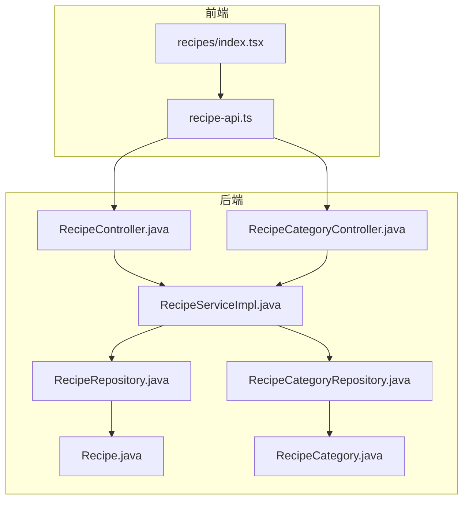
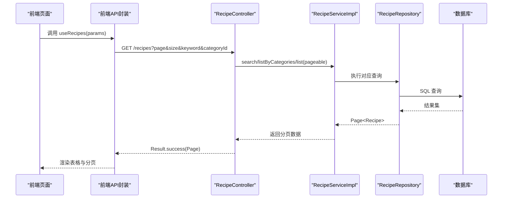
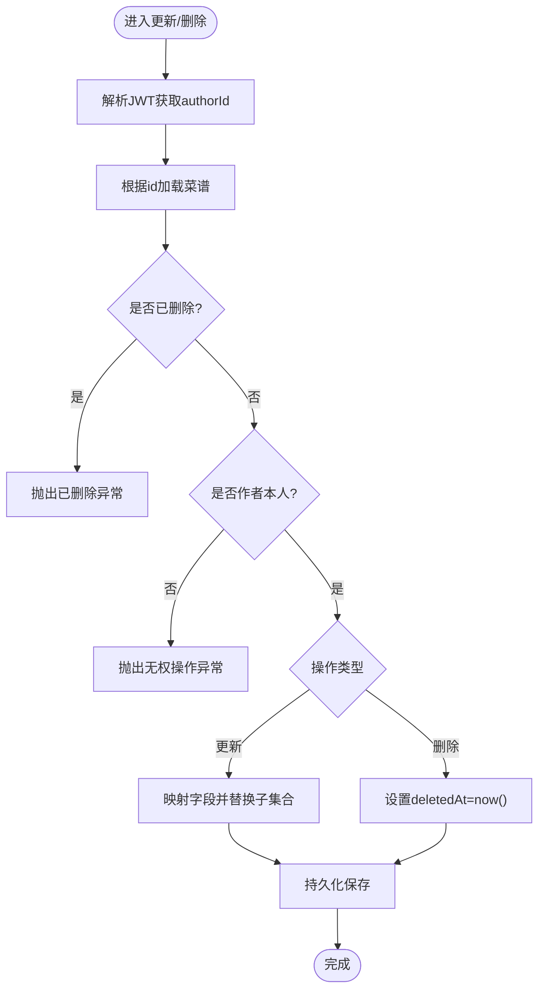
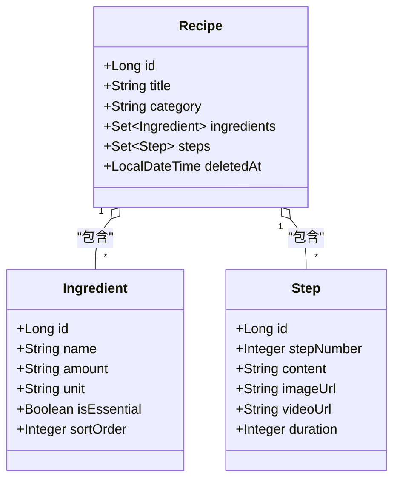
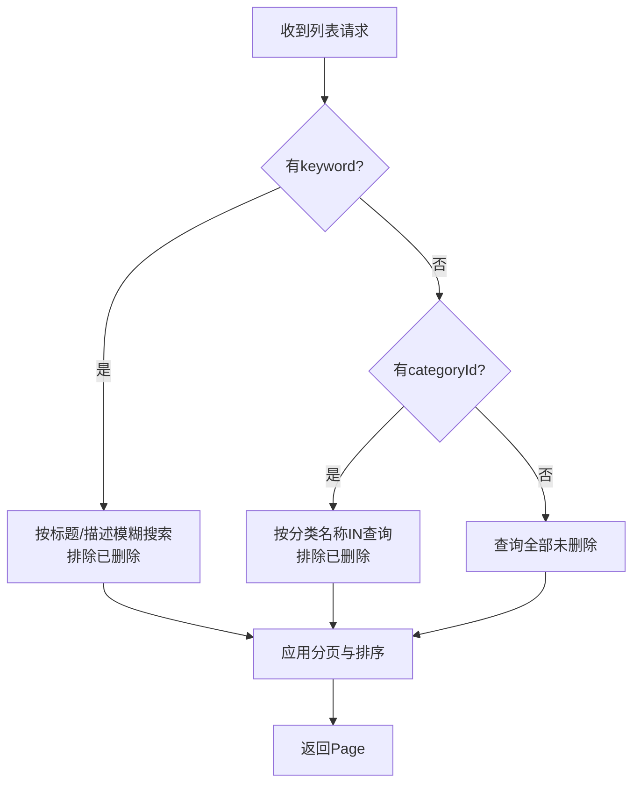
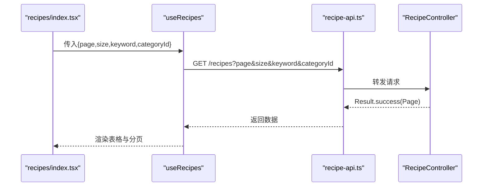
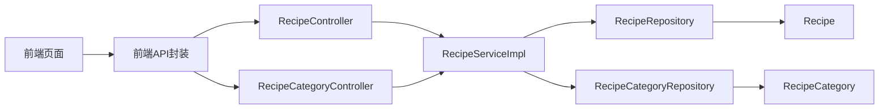
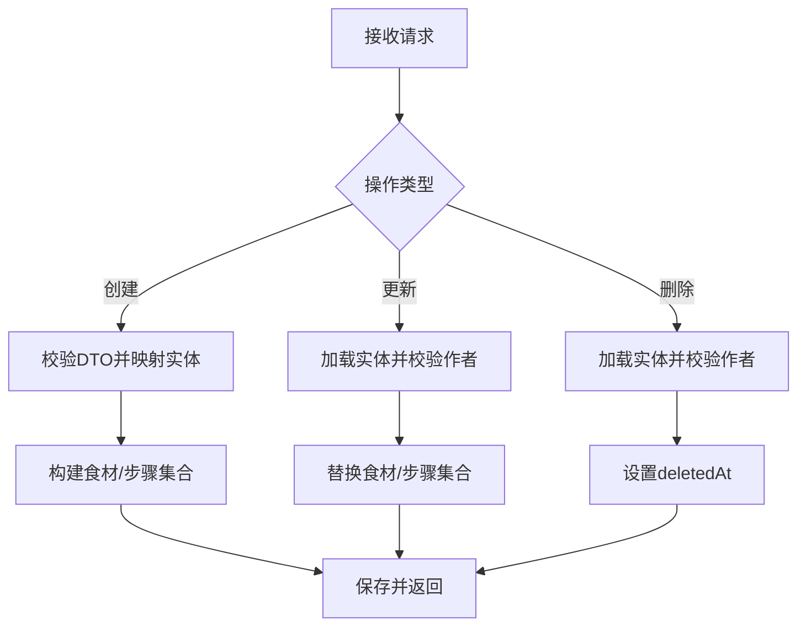

# 菜谱管理功能

<cite>
**本文引用的文件**
- [RecipeController.java](file://java_server/po/src/main/java/com/goodzheng/po/controller/RecipeController.java)
- [RecipeCategoryController.java](file://java_server/po/src/main/java/com/goodzheng/po/controller/RecipeCategoryController.java)
- [RecipeService.java](file://java_server/po/src/main/java/com/goodzheng/po/service/RecipeService.java)
- [RecipeServiceImpl.java](file://java_server/po/src/main/java/com/goodzheng/po/service/impl/RecipeServiceImpl.java)
- [RecipeRepository.java](file://java_server/po/src/main/java/com/goodzheng/po/repository/RecipeRepository.java)
- [RecipeCategoryRepository.java](file://java_server/po/src/main/java/com/goodzheng/po/repository/RecipeCategoryRepository.java)
- [RecipeRequest.java](file://java_server/po/src/main/java/com/goodzheng/po/dto/RecipeRequest.java)
- [Recipe.java](file://java_server/po/src/main/java/com/goodzheng/po/entity/Recipe.java)
- [RecipeCategory.java](file://java_server/po/src/main/java/com/goodzheng/po/entity/RecipeCategory.java)
- [Ingredient.java](file://java_server/po/src/main/java/com/goodzheng/po/entity/Ingredient.java)
- [Step.java](file://java_server/po/src/main/java/com/goodzheng/po/entity/Step.java)
- [recipe-api.ts](file://web_client/shadcn-admin/src/features/recipes/api/recipe-api.ts)
- [recipes/index.tsx](file://web_client/shadcn-admin/src/features/recipes/index.tsx)
</cite>

## 目录
1. [简介](#简介)
2. [项目结构](#项目结构)
3. [核心组件](#核心组件)
4. [架构总览](#架构总览)
5. [详细组件分析](#详细组件分析)
6. [依赖关系分析](#依赖关系分析)
7. [性能考虑](#性能考虑)
8. [故障排查指南](#故障排查指南)
9. [结论](#结论)
10. [附录：API 规范与使用指南](#附录api-规范与使用指南)

## 简介
本技术文档围绕“菜谱管理”功能，系统阐述后端 CRUD、分类管理、搜索分页、权限控制、软删除机制以及前端交互。面向初学者提供使用指南，面向开发者提供扩展指导，并给出关键流程的可视化图示与代码级引用路径。

## 项目结构
- 后端（Spring Boot）
  - 控制器层：菜谱与分类接口定义
  - 服务层：业务逻辑（创建/更新/删除/查询/搜索）
  - 数据访问层：JPA Repository（含自定义查询）
  - 实体与DTO：领域模型与请求体
- 前端（React + TanStack Query）
  - 页面路由与列表展示
  - 数据获取与缓存（useQuery/useMutation）
  - 表单与交互（通过对话框与表格组件组合）

**图表来源**
- [recipes/index.tsx:1-82](file://web_client/shadcn-admin/src/features/recipes/index.tsx#L1-L82)
- [recipe-api.ts:1-161](file://web_client/shadcn-admin/src/features/recipes/api/recipe-api.ts#L1-L161)
- [RecipeController.java:18-119](file://java_server/po/src/main/java/com/goodzheng/po/controller/RecipeController.java#L18-L119)
- [RecipeCategoryController.java:11-28](file://java_server/po/src/main/java/com/goodzheng/po/controller/RecipeCategoryController.java#L11-L28)
- [RecipeServiceImpl.java:19-174](file://java_server/po/src/main/java/com/goodzheng/po/service/impl/RecipeServiceImpl.java#L19-L174)
- [RecipeRepository.java:13-35](file://java_server/po/src/main/java/com/goodzheng/po/repository/RecipeRepository.java#L13-L35)
- [RecipeCategoryRepository.java:10-17](file://java_server/po/src/main/java/com/goodzheng/po/repository/RecipeCategoryRepository.java#L10-L17)
- [Recipe.java:10-92](file://java_server/po/src/main/java/com/goodzheng/po/entity/Recipe.java#L10-L92)
- [RecipeCategory.java:8-45](file://java_server/po/src/main/java/com/goodzheng/po/entity/RecipeCategory.java#L8-L45)

**章节来源**
- [RecipeController.java:18-119](file://java_server/po/src/main/java/com/goodzheng/po/controller/RecipeController.java#L18-L119)
- [RecipeCategoryController.java:11-28](file://java_server/po/src/main/java/com/goodzheng/po/controller/RecipeCategoryController.java#L11-L28)
- [RecipeServiceImpl.java:19-174](file://java_server/po/src/main/java/com/goodzheng/po/service/impl/RecipeServiceImpl.java#L19-L174)
- [RecipeRepository.java:13-35](file://java_server/po/src/main/java/com/goodzheng/po/repository/RecipeRepository.java#L13-L35)
- [RecipeCategoryRepository.java:10-17](file://java_server/po/src/main/java/com/goodzheng/po/repository/RecipeCategoryRepository.java#L10-L17)
- [Recipe.java:10-92](file://java_server/po/src/main/java/com/goodzheng/po/entity/Recipe.java#L10-L92)
- [RecipeCategory.java:8-45](file://java_server/po/src/main/java/com/goodzheng/po/entity/RecipeCategory.java#L8-L45)
- [recipes/index.tsx:1-82](file://web_client/shadcn-admin/src/features/recipes/index.tsx#L1-L82)
- [recipe-api.ts:1-161](file://web_client/shadcn-admin/src/features/recipes/api/recipe-api.ts#L1-L161)

## 核心组件
- 控制器
  - 菜谱：创建、详情、分页列表、我的菜谱、更新、删除（软删除）
  - 分类：列出所有未删除的分类
- 服务
  - 菜谱：创建/更新映射、权限校验、软删除、按作者/分类/关键词查询
  - 分类：按排序返回未删除分类
- 仓储
  - 菜谱：JOIN FETCH 预加载、分页过滤已删除、按作者/分类/关键词查询
  - 分类：按排序查询、按 ID 批量取名称
- 实体与 DTO
  - Recipe/Ingredient/Step：包含软删除字段、时间戳、关联集合
  - RecipeRequest：带验证注解的请求体（标题、难度、食材、步骤等）

**章节来源**
- [RecipeController.java:28-118](file://java_server/po/src/main/java/com/goodzheng/po/controller/RecipeController.java#L28-L118)
- [RecipeCategoryController.java:19-27](file://java_server/po/src/main/java/com/goodzheng/po/controller/RecipeCategoryController.java#L19-L27)
- [RecipeService.java:10-27](file://java_server/po/src/main/java/com/goodzheng/po/service/RecipeService.java#L10-L27)
- [RecipeServiceImpl.java:26-172](file://java_server/po/src/main/java/com/goodzheng/po/service/impl/RecipeServiceImpl.java#L26-L172)
- [RecipeRepository.java:16-34](file://java_server/po/src/main/java/com/goodzheng/po/repository/RecipeRepository.java#L16-L34)
- [RecipeCategoryRepository.java:12-16](file://java_server/po/src/main/java/com/goodzheng/po/repository/RecipeCategoryRepository.java#L12-L16)
- [RecipeRequest.java:10-65](file://java_server/po/src/main/java/com/goodzheng/po/dto/RecipeRequest.java#L10-L65)
- [Recipe.java:10-92](file://java_server/po/src/main/java/com/goodzheng/po/entity/Recipe.java#L10-L92)
- [Ingredient.java:9-41](file://java_server/po/src/main/java/com/goodzheng/po/entity/Ingredient.java#L9-L41)
- [Step.java:9-39](file://java_server/po/src/main/java/com/goodzheng/po/entity/Step.java#L9-L39)

## 架构总览
前后端分层清晰：前端通过 React Query 发起请求，后端 Controller 接收参数并调用 Service，Service 进行业务校验与事务处理，最终通过 Repository 访问数据库。

**图表来源**
- [recipes/index.tsx:24-36](file://web_client/shadcn-admin/src/features/recipes/index.tsx#L24-L36)
- [recipe-api.ts:82-97](file://web_client/shadcn-admin/src/features/recipes/api/recipe-api.ts#L82-L97)
- [RecipeController.java:51-68](file://java_server/po/src/main/java/com/goodzheng/po/controller/RecipeController.java#L51-L68)
- [RecipeServiceImpl.java:92-97](file://java_server/po/src/main/java/com/goodzheng/po/service/impl/RecipeServiceImpl.java#L92-L97)
- [RecipeRepository.java:20-34](file://java_server/po/src/main/java/com/goodzheng/po/repository/RecipeRepository.java#L20-L34)

## 详细组件分析

### 菜谱 CRUD 与权限控制
- 创建
  - 入口：POST /recipes
  - 数据验证：基于 DTO 的注解校验（如标题必填、难度必填）
  - 业务：设置作者ID，构建食材与步骤集合，保存后返回
- 详情
  - 入口：GET /recipes/{id}
  - 预加载：JOIN FETCH 食材与步骤，避免懒加载异常
  - 软删除检查：若已删除则抛出异常
- 更新
  - 入口：PUT /recipes/{id}
  - 权限控制：校验当前用户是否为作者，否则拒绝
  - 替换策略：清空并重建食材与步骤集合
- 删除（软删除）
  - 入口：DELETE /recipes/{id}
  - 权限控制：仅作者可删除
  - 实现：写入 deletedAt 时间戳，后续查询均过滤已删除记录

**图表来源**
- [RecipeController.java:85-109](file://java_server/po/src/main/java/com/goodzheng/po/controller/RecipeController.java#L85-L109)
- [RecipeServiceImpl.java:99-151](file://java_server/po/src/main/java/com/goodzheng/po/service/impl/RecipeServiceImpl.java#L99-L151)
- [RecipeRepository.java:20-24](file://java_server/po/src/main/java/com/goodzheng/po/repository/RecipeRepository.java#L20-L24)

**章节来源**
- [RecipeController.java:28-118](file://java_server/po/src/main/java/com/goodzheng/po/controller/RecipeController.java#L28-L118)
- [RecipeServiceImpl.java:26-151](file://java_server/po/src/main/java/com/goodzheng/po/service/impl/RecipeServiceImpl.java#L26-L151)
- [RecipeRepository.java:16-24](file://java_server/po/src/main/java/com/goodzheng/po/repository/RecipeRepository.java#L16-L24)
- [RecipeRequest.java:10-65](file://java_server/po/src/main/java/com/goodzheng/po/dto/RecipeRequest.java#L10-L65)

### 分类管理与多级支持
- 分类查询
  - 入口：GET /recipe-categories
  - 返回：未删除的分类，按 sortOrder 升序
- 分类关联
  - 菜谱实体包含 category 字符串字段；多分类筛选时，前端传 categoryId 列表，后端通过 ID 查名称再按名称 IN 查询
- 多级分类支持
  - 当前模型为扁平分类表；如需多级，可在分类表中增加 parentId 字段并在查询中递归或层级聚合

**图表来源**
- [Recipe.java:84-92](file://java_server/po/src/main/java/com/goodzheng/po/entity/Recipe.java#L84-L92)
- [Ingredient.java:18-41](file://java_server/po/src/main/java/com/goodzheng/po/entity/Ingredient.java#L18-L41)
- [Step.java:18-39](file://java_server/po/src/main/java/com/goodzheng/po/entity/Step.java#L18-L39)

**章节来源**
- [RecipeCategoryController.java:19-27](file://java_server/po/src/main/java/com/goodzheng/po/controller/RecipeCategoryController.java#L19-L27)
- [RecipeCategoryRepository.java:12-16](file://java_server/po/src/main/java/com/goodzheng/po/repository/RecipeCategoryRepository.java#L12-L16)
- [RecipeServiceImpl.java:85-90](file://java_server/po/src/main/java/com/goodzheng/po/service/impl/RecipeServiceImpl.java#L85-L90)
- [Recipe.java:40-46](file://java_server/po/src/main/java/com/goodzheng/po/entity/Recipe.java#L40-L46)

### 搜索与分页
- 关键词搜索
  - 入口：GET /recipes?keyword=...
  - 算法：对标题与描述进行模糊匹配（OR 条件），同时排除已删除记录
- 多条件组合
  - 支持按分类筛选（categoryId 列表）与关键词并存时的分支选择
- 分页
  - 默认 page=0, size=20，按 createdAt 降序排列
- 性能优化
  - JOIN FETCH 预加载详情，减少 N+1
  - 使用 Spring Data 派生查询与 @Query 精准过滤
  - 前端使用 React Query 缓存与去重

**图表来源**
- [RecipeController.java:51-68](file://java_server/po/src/main/java/com/goodzheng/po/controller/RecipeController.java#L51-L68)
- [RecipeServiceImpl.java:73-97](file://java_server/po/src/main/java/com/goodzheng/po/service/impl/RecipeServiceImpl.java#L73-L97)
- [RecipeRepository.java:20-34](file://java_server/po/src/main/java/com/goodzheng/po/repository/RecipeRepository.java#L20-L34)

**章节来源**
- [RecipeController.java:51-68](file://java_server/po/src/main/java/com/goodzheng/po/controller/RecipeController.java#L51-L68)
- [RecipeServiceImpl.java:73-97](file://java_server/po/src/main/java/com/goodzheng/po/service/impl/RecipeServiceImpl.java#L73-L97)
- [RecipeRepository.java:20-34](file://java_server/po/src/main/java/com/goodzheng/po/repository/RecipeRepository.java#L20-L34)
- [recipe-api.ts:82-97](file://web_client/shadcn-admin/src/features/recipes/api/recipe-api.ts#L82-L97)

### 前端界面交互
- 列表页
  - 从 URL 读取 page、pageSize、keyword、categoryId，转换为后端参数
  - 使用 useRecipes 发起查询，展示加载中/错误/数据表格
- 详情与编辑
  - 通过 useRecipe 获取详情，使用 useCreateRecipe/useUpdateRecipe 提交表单
- 删除
  - 使用 useDeleteRecipe 触发软删除，成功后刷新列表缓存

**图表来源**
- [recipes/index.tsx:24-75](file://web_client/shadcn-admin/src/features/recipes/index.tsx#L24-L75)
- [recipe-api.ts:82-97](file://web_client/shadcn-admin/src/features/recipes/api/recipe-api.ts#L82-L97)
- [RecipeController.java:51-68](file://java_server/po/src/main/java/com/goodzheng/po/controller/RecipeController.java#L51-L68)

**章节来源**
- [recipes/index.tsx:1-82](file://web_client/shadcn-admin/src/features/recipes/index.tsx#L1-L82)
- [recipe-api.ts:67-161](file://web_client/shadcn-admin/src/features/recipes/api/recipe-api.ts#L67-L161)

## 依赖关系分析
- 控制器依赖服务，服务依赖仓储，仓储依赖实体
- 前端依赖后端 REST 接口，使用 React Query 管理状态与缓存
- 事务边界在 Service 层，确保创建/更新/删除的原子性

**图表来源**
- [recipes/index.tsx:1-82](file://web_client/shadcn-admin/src/features/recipes/index.tsx#L1-L82)
- [recipe-api.ts:1-161](file://web_client/shadcn-admin/src/features/recipes/api/recipe-api.ts#L1-L161)
- [RecipeController.java:18-119](file://java_server/po/src/main/java/com/goodzheng/po/controller/RecipeController.java#L18-L119)
- [RecipeCategoryController.java:11-28](file://java_server/po/src/main/java/com/goodzheng/po/controller/RecipeCategoryController.java#L11-L28)
- [RecipeServiceImpl.java:19-174](file://java_server/po/src/main/java/com/goodzheng/po/service/impl/RecipeServiceImpl.java#L19-L174)
- [RecipeRepository.java:13-35](file://java_server/po/src/main/java/com/goodzheng/po/repository/RecipeRepository.java#L13-L35)
- [RecipeCategoryRepository.java:10-17](file://java_server/po/src/main/java/com/goodzheng/po/repository/RecipeCategoryRepository.java#L10-L17)
- [Recipe.java:10-92](file://java_server/po/src/main/java/com/goodzheng/po/entity/Recipe.java#L10-L92)
- [RecipeCategory.java:8-45](file://java_server/po/src/main/java/com/goodzheng/po/entity/RecipeCategory.java#L8-L45)

**章节来源**
- [RecipeServiceImpl.java:19-174](file://java_server/po/src/main/java/com/goodzheng/po/service/impl/RecipeServiceImpl.java#L19-L174)
- [RecipeRepository.java:13-35](file://java_server/po/src/main/java/com/goodzheng/po/repository/RecipeRepository.java#L13-L35)
- [RecipeCategoryRepository.java:10-17](file://java_server/po/src/main/java/com/goodzheng/po/repository/RecipeCategoryRepository.java#L10-L17)

## 性能考虑
- 查询优化
  - 详情查询使用 JOIN FETCH 预加载关联集合，避免 N+1 问题
  - 列表查询通过 Spring Data 派生方法过滤已删除记录，减少无效数据
- 分页与排序
  - 统一按 createdAt 降序，提升列表一致性
  - 合理设置 page 与 size，避免一次性拉取过多数据
- 前端缓存
  - 使用 React Query 的 queryKey 与 staleTime 减少重复请求
- 可扩展建议
  - 对高频搜索字段建立索引（如 title、description）
  - 复杂筛选可引入 Elasticsearch 或数据库全文检索

[本节为通用性能建议，不直接分析具体文件]

## 故障排查指南
- 常见错误
  - 401/400：认证失败或参数校验失败（检查 Authorization 头与 DTO 校验规则）
  - 404：菜谱不存在或已删除（检查 id 与 deletedAt 状态）
  - 500：服务端异常（查看日志与异常堆栈）
- 定位步骤
  - 确认前端请求参数与后端接口一致
  - 检查 Service 层权限校验与事务边界
  - 核对 Repository 查询是否包含必要过滤条件

**章节来源**
- [RecipeController.java:28-118](file://java_server/po/src/main/java/com/goodzheng/po/controller/RecipeController.java#L28-L118)
- [RecipeServiceImpl.java:62-151](file://java_server/po/src/main/java/com/goodzheng/po/service/impl/RecipeServiceImpl.java#L62-L151)
- [recipe-api.ts:112-161](file://web_client/shadcn-admin/src/features/recipes/api/recipe-api.ts#L112-L161)

## 结论
该菜谱管理系统在后端实现了完整的 CRUD、权限控制与软删除，在前端提供了良好的列表、搜索与分页体验。通过清晰的层次划分与合理的查询优化，具备较好的可维护性与扩展性。未来可按需引入多级分类、全文检索与更丰富的统计指标。

[本节为总结性内容，不直接分析具体文件]

## 附录：API 规范与使用指南

### 接口规范
- 菜谱
  - POST /recipes：创建菜谱（需要 Authorization 头）
  - GET /recipes/{id}：获取详情
  - GET /recipes：分页列表（支持 keyword、categoryId）
  - GET /recipes/mine：我的菜谱（需要 Authorization 头）
  - PUT /recipes/{id}：更新菜谱（需要 Authorization 头）
  - DELETE /recipes/{id}：软删除（需要 Authorization 头）
- 分类
  - GET /recipe-categories：列出所有未删除分类

**章节来源**
- [RecipeController.java:28-118](file://java_server/po/src/main/java/com/goodzheng/po/controller/RecipeController.java#L28-L118)
- [RecipeCategoryController.java:19-27](file://java_server/po/src/main/java/com/goodzheng/po/controller/RecipeCategoryController.java#L19-L27)

### 数据模型设计
- Recipe：主实体，包含基础信息、营养字段、软删除字段、时间戳及与 Ingredient/Step 的一对多关系
- Ingredient/Step：子实体，分别表示食材与步骤，通过 recipe_id 关联
- RecipeCategory：分类实体，支持排序与软删除

**章节来源**
- [Recipe.java:10-92](file://java_server/po/src/main/java/com/goodzheng/po/entity/Recipe.java#L10-L92)
- [Ingredient.java:9-41](file://java_server/po/src/main/java/com/goodzheng/po/entity/Ingredient.java#L9-L41)
- [Step.java:9-39](file://java_server/po/src/main/java/com/goodzheng/po/entity/Step.java#L9-L39)
- [RecipeCategory.java:8-45](file://java_server/po/src/main/java/com/goodzheng/po/entity/RecipeCategory.java#L8-L45)

### 业务逻辑流程图（创建/更新/删除）

**图表来源**
- [RecipeServiceImpl.java:26-151](file://java_server/po/src/main/java/com/goodzheng/po/service/impl/RecipeServiceImpl.java#L26-L151)

### 复杂查询与批量操作示例（代码片段路径）
- 多条件组合查询（关键词/分类/分页）
  - 参考：[RecipeController.java:51-68](file://java_server/po/src/main/java/com/goodzheng/po/controller/RecipeController.java#L51-L68)
  - 参考：[RecipeServiceImpl.java:73-97](file://java_server/po/src/main/java/com/goodzheng/po/service/impl/RecipeServiceImpl.java#L73-L97)
  - 参考：[RecipeRepository.java:20-34](file://java_server/po/src/main/java/com/goodzheng/po/repository/RecipeRepository.java#L20-L34)
- 批量操作（前端批量删除/更新）
  - 可通过循环调用 useDeleteRecipe/useUpdateRecipe 实现，参考：
    - [recipe-api.ts:129-161](file://web_client/shadcn-admin/src/features/recipes/api/recipe-api.ts#L129-L161)

### 初学者使用指南
- 首次使用
  - 准备 JWT 令牌，放入 Authorization 头
  - 通过 GET /recipe-categories 获取分类列表用于筛选
- 创建菜谱
  - 填写必填字段（标题、难度），可选填写食材与步骤
  - 提交后刷新列表即可看到新菜谱
- 编辑与删除
  - 仅作者可编辑或删除
  - 删除为软删除，可在数据库中查看 deletedAt 字段

[本节为使用指导，不直接分析具体文件]