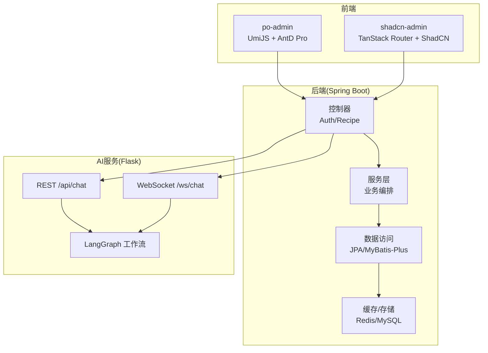
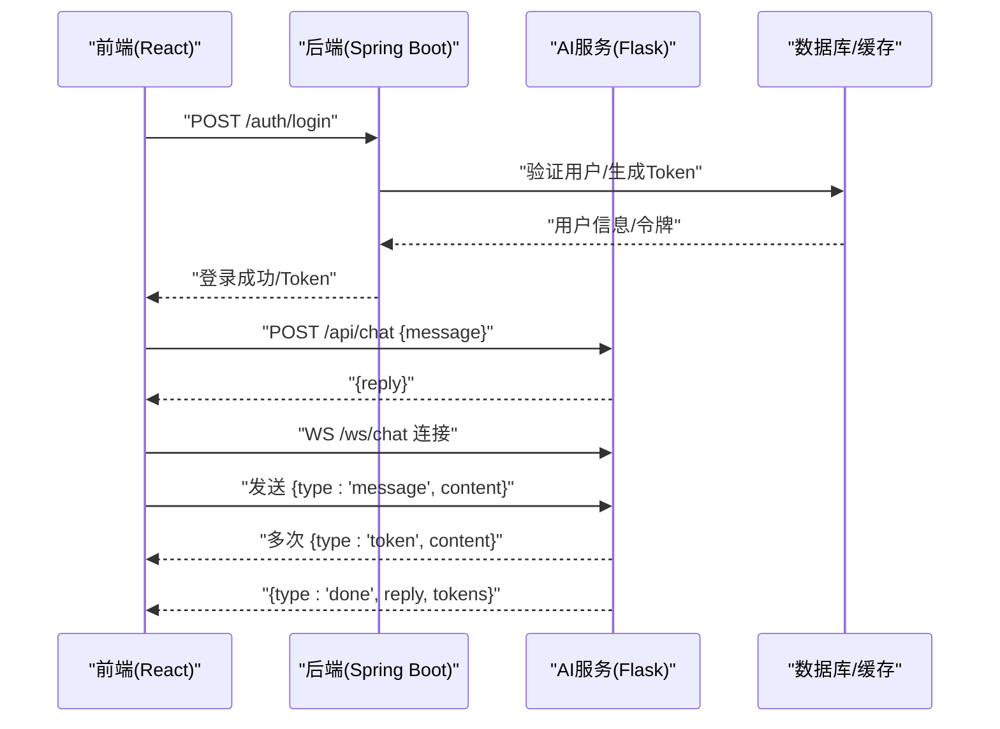
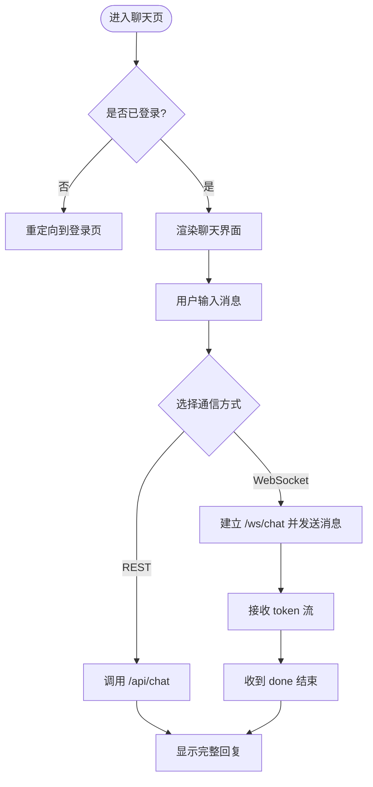
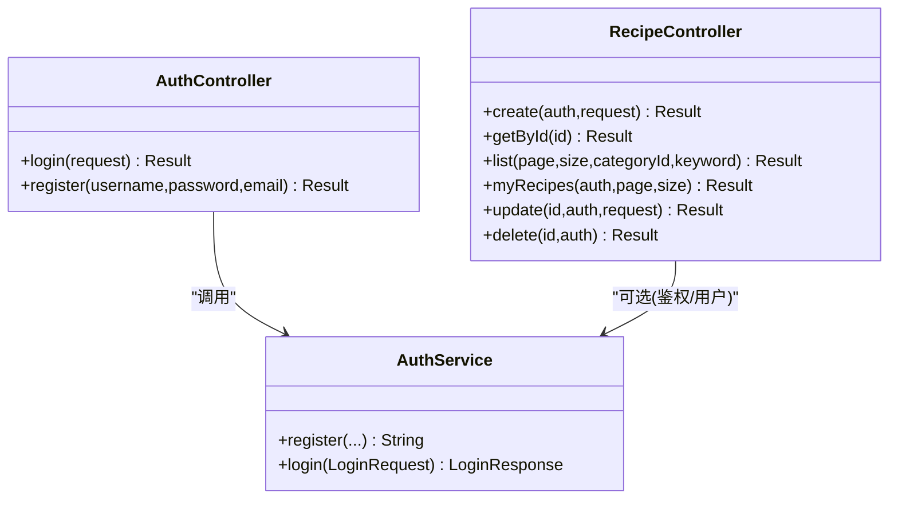
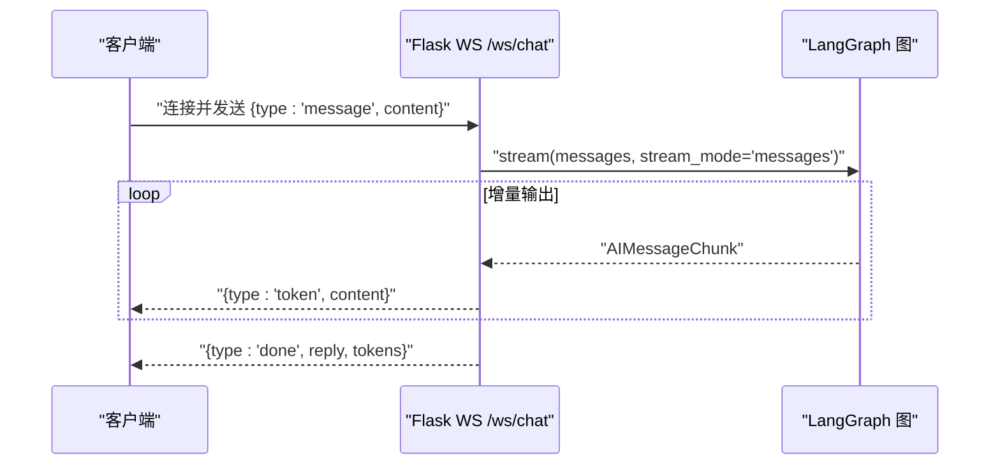
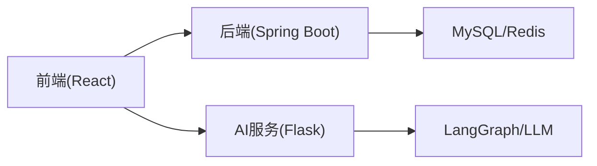

# 系统架构概览

<cite>
**本文引用的文件**
- [PoApplication.java](file://java_server/po/src/main/java/com/goodzheng/po/PoApplication.java)
- [application.yaml](file://java_server/po/src/main/resources/application.yaml)
- [AuthController.java](file://java_server/po/src/main/java/com/goodzheng/po/controller/AuthController.java)
- [RecipeController.java](file://java_server/po/src/main/java/com/goodzheng/po/controller/RecipeController.java)
- [AuthService.java](file://java_server/po/src/main/java/com/goodzheng/po/service/AuthService.java)
- [pom.xml](file://java_server/po/pom.xml)
- [app.py](file://py_server/app.py)
- [chat.py](file://py_server/blueprints/chat.py)
- [ws.py](file://py_server/blueprints/ws.py)
- [chat_graph.py](file://py_server/agents/chat_graph.py)
- [requirements.txt](file://py_server/requirements.txt)
- [app.tsx](file://web_client/po-admin/src/app.tsx)
- [index.tsx](file://web_client/shadcn-admin/src/routes/_authenticated/chats/index.tsx)
- [chats/index.tsx](file://web_client/shadcn-admin/src/features/chats/index.tsx)
</cite>

## 目录
1. [简介](#简介)
2. [项目结构](#项目结构)
3. [核心组件](#核心组件)
4. [架构总览](#架构总览)
5. [详细组件分析](#详细组件分析)
6. [依赖关系分析](#依赖关系分析)
7. [性能与扩展性](#性能与扩展性)
8. [故障排查指南](#故障排查指南)
9. [结论](#结论)
10. [附录：技术选型说明](#附录技术选型说明)

## 简介
本系统采用前后端分离的三层架构：前端 React 应用、Java Spring Boot 后端服务、Python Flask AI 服务。整体目标是提供用户认证、菜谱管理等业务功能，并通过 RESTful API 与 WebSocket 两种通信方式与 AI 服务交互，实现一次性回复与流式对话能力。微服务化设计使各层职责清晰、可独立部署与扩展，便于持续演进。

## 项目结构
- 前端（React）
  - po-admin：基于 UmiJS/Ant Design Pro 的管理后台，负责路由、布局、请求拦截与页面组织。
  - shadcn-admin：基于 TanStack Router + ShadCN UI 的另一套前端工程，包含聊天等特性页面。
- 后端（Spring Boot）
  - 提供 RESTful API，封装认证、菜谱等业务逻辑，使用 JPA/MyBatis-Plus、Redis、MySQL 等基础设施。
- AI 服务（Flask）
  - 暴露 REST 接口与 WebSocket 接口，基于 LangGraph 构建 ReAct 工作流，支持工具调用与流式输出。

图表来源
- [app.tsx:192-195](file://web_client/po-admin/src/app.tsx#L192-L195)
- [index.tsx:4-6](file://web_client/shadcn-admin/src/routes/_authenticated/chats/index.tsx#L4-L6)
- [AuthController.java:11-39](file://java_server/po/src/main/java/com/goodzheng/po/controller/AuthController.java#L11-L39)
- [RecipeController.java:18-119](file://java_server/po/src/main/java/com/goodzheng/po/controller/RecipeController.java#L18-L119)
- [application.yaml:24-53](file://java_server/po/src/main/resources/application.yaml#L24-L53)
- [app.py:24-47](file://py_server/app.py#L24-L47)
- [chat.py:7-23](file://py_server/blueprints/chat.py#L7-L23)
- [ws.py:23-89](file://py_server/blueprints/ws.py#L23-L89)
- [chat_graph.py:75-86](file://py_server/agents/chat_graph.py#L75-L86)

章节来源
- [application.yaml:4-10](file://java_server/po/src/main/resources/application.yaml#L4-L10)
- [pom.xml:32-115](file://java_server/po/pom.xml#L32-L115)
- [requirements.txt:1-13](file://py_server/requirements.txt#L1-L13)

## 核心组件
- 前端
  - 路由与布局：UmiJS 运行时配置、全局请求基地址、错误处理；TanStack Router 文件路由。
  - 页面：聊天页、仪表盘、用户中心等模块，通过组件化开发提升复用与维护性。
- 后端
  - 控制器：认证登录/注册、菜谱 CRUD、分页查询、权限校验（JWT）。
  - 服务层：业务编排与异常处理。
  - 数据层：JPA/MyBatis-Plus、Redis 缓存、MySQL 持久化。
- AI 服务
  - REST：一次性返回完整回复。
  - WebSocket：逐 token 推送流式回复，支持心跳与错误消息。
  - 工作流：LangGraph 构建 ReAct 循环，支持工具调用与离线降级。

章节来源
- [AuthController.java:11-39](file://java_server/po/src/main/java/com/goodzheng/po/controller/AuthController.java#L11-L39)
- [RecipeController.java:18-119](file://java_server/po/src/main/java/com/goodzheng/po/controller/RecipeController.java#L18-L119)
- [AuthService.java:6-11](file://java_server/po/src/main/java/com/goodzheng/po/service/AuthService.java#L6-L11)
- [chat.py:7-23](file://py_server/blueprints/chat.py#L7-L23)
- [ws.py:23-89](file://py_server/blueprints/ws.py#L23-L89)
- [chat_graph.py:40-86](file://py_server/agents/chat_graph.py#L40-L86)

## 架构总览
系统采用“前端—后端—AI 服务”的解耦分层：
- 前端负责展示与交互，统一通过 HTTP/WebSocket 与后端或 AI 服务通信。
- 后端负责业务编排、鉴权、数据持久化，并可转发或聚合 AI 能力。
- AI 服务专注大模型工作流编排与流式输出，对外暴露 REST 与 WS 接口。

图表来源
- [AuthController.java:19-27](file://java_server/po/src/main/java/com/goodzheng/po/controller/AuthController.java#L19-L27)
- [chat.py:10-23](file://py_server/blueprints/chat.py#L10-L23)
- [ws.py:30-89](file://py_server/blueprints/ws.py#L30-L89)

## 详细组件分析

### 前端（React）
- 入口与运行时
  - UmiJS 全局初始化、请求基地址、错误处理策略。
  - 路由守卫：未登录时重定向至登录页。
- 聊天页面
  - 基于 TanStack Router 的文件路由挂载聊天组件。
  - 聊天界面组件化，支持搜索、列表、消息展示与输入。

图表来源
- [app.tsx:32-73](file://web_client/po-admin/src/app.tsx#L32-L73)
- [index.tsx:4-6](file://web_client/shadcn-admin/src/routes/_authenticated/chats/index.tsx#L4-L6)
- [chats/index.tsx:34-354](file://web_client/shadcn-admin/src/features/chats/index.tsx#L34-L354)

章节来源
- [app.tsx:192-195](file://web_client/po-admin/src/app.tsx#L192-L195)
- [index.tsx:4-6](file://web_client/shadcn-admin/src/routes/_authenticated/chats/index.tsx#L4-L6)
- [chats/index.tsx:67-354](file://web_client/shadcn-admin/src/features/chats/index.tsx#L67-L354)

### 后端（Spring Boot）
- 启动与配置
  - 应用入口类启用自动装配。
  - 配置文件定义服务器端口、上下文路径、数据源、Redis、日志与监控端点。
- 控制器与服务
  - 认证控制器：登录/注册，统一返回结果对象，异常转换为错误响应。
  - 菜谱控制器：创建、查询、更新、删除，支持分页、关键词与分类过滤，基于 JWT 解析用户身份。
  - 服务层接口：定义认证相关方法，具体实现位于 service.impl 包中。
- 数据访问
  - 使用 JPA/MyBatis-Plus 进行 ORM 操作，结合 Redis 做缓存。

图表来源
- [AuthController.java:11-39](file://java_server/po/src/main/java/com/goodzheng/po/controller/AuthController.java#L11-L39)
- [RecipeController.java:18-119](file://java_server/po/src/main/java/com/goodzheng/po/controller/RecipeController.java#L18-L119)
- [AuthService.java:6-11](file://java_server/po/src/main/java/com/goodzheng/po/service/AuthService.java#L6-L11)

章节来源
- [PoApplication.java:6-11](file://java_server/po/src/main/java/com/goodzheng/po/PoApplication.java#L6-L11)
- [application.yaml:4-109](file://java_server/po/src/main/resources/application.yaml#L4-L109)
- [AuthController.java:11-39](file://java_server/po/src/main/java/com/goodzheng/po/controller/AuthController.java#L11-L39)
- [RecipeController.java:18-119](file://java_server/po/src/main/java/com/goodzheng/po/controller/RecipeController.java#L18-L119)
- [AuthService.java:6-11](file://java_server/po/src/main/java/com/goodzheng/po/service/AuthService.java#L6-L11)

### AI 服务（Flask + LangGraph）
- 应用工厂
  - 创建 Flask 应用，注册蓝图，初始化 CORS 与 WebSocket 扩展，预热编译 LangGraph 图。
- REST 接口
  - POST /api/chat：接收消息，调用 LangGraph 图一次性返回完整回复。
- WebSocket 接口
  - /ws/chat：协议包括 message/ping/token/done/error，流式推送 token，支持心跳与错误处理。
- 工作流
  - 基于 LangGraph 的 StateGraph 构建 ReAct 循环，支持工具调用与离线降级（FakeListChatModel）。

图表来源
- [app.py:24-47](file://py_server/app.py#L24-L47)
- [chat.py:10-23](file://py_server/blueprints/chat.py#L10-L23)
- [ws.py:30-89](file://py_server/blueprints/ws.py#L30-L89)
- [chat_graph.py:75-86](file://py_server/agents/chat_graph.py#L75-L86)

章节来源
- [app.py:1-51](file://py_server/app.py#L1-L51)
- [chat.py:1-24](file://py_server/blueprints/chat.py#L1-L24)
- [ws.py:1-90](file://py_server/blueprints/ws.py#L1-L90)
- [chat_graph.py:1-92](file://py_server/agents/chat_graph.py#L1-L92)

## 依赖关系分析
- 前端依赖
  - UmiJS/AntD Pro：路由、布局、请求封装。
  - TanStack Router/ShadCN：模块化路由与 UI 组件。
- 后端依赖
  - Spring Boot Starter Web、Data JPA、Validation、Security Crypto、Actuator、Prometheus。
  - MyBatis-Plus、MySQL Connector、Redis/Jedis、JWT 库。
- AI 服务依赖
  - Flask、Flask-Sock、Flask-CORS。
  - LangChain、LangGraph、OpenAI 兼容客户端。

图表来源
- [pom.xml:32-115](file://java_server/po/pom.xml#L32-L115)
- [requirements.txt:1-13](file://py_server/requirements.txt#L1-L13)

章节来源
- [pom.xml:32-115](file://java_server/po/pom.xml#L32-L115)
- [requirements.txt:1-13](file://py_server/requirements.txt#L1-L13)

## 性能与扩展性
- 微服务优势
  - 服务解耦：前端、后端、AI 服务各自独立演进，降低耦合度。
  - 独立部署：可按需扩容 AI 服务以应对高并发流式请求，后端按业务负载水平扩展。
  - 弹性伸缩：AI 服务可通过多实例+负载均衡提升吞吐；后端通过线程池与连接池优化。
- 通信机制
  - RESTful API：适合一次性请求/响应场景，如登录、菜谱 CRUD。
  - WebSocket：适合实时流式场景，如逐 token 推送，提升用户体验。
- 数据流转
  - 前端发起请求 → 后端鉴权与业务编排 → 必要时调用 AI 服务 → 返回结果或流式数据。
- 优化建议
  - 后端：合理设置 Tomcat 线程数、连接池大小；引入缓存减少热点查询。
  - AI 服务：对 LangGraph 图进行预热与缓存；限制单次消息长度与频率；增加重试与熔断。
  - 前端：对长列表与消息流进行虚拟滚动与增量渲染，避免阻塞 UI。

[本节为通用指导，不直接分析具体文件]

## 故障排查指南
- 后端常见问题
  - 登录失败：检查认证控制器异常分支与错误码返回。
  - 权限问题：确认 Authorization 头格式与 JWT 解析逻辑。
  - 数据库连接：核对 application.yaml 中的数据源与 Redis 配置。
- AI 服务常见问题
  - REST 调用失败：查看 chat 蓝图的异常捕获与日志。
  - WebSocket 断连：检查 ws 蓝图的连接关闭与错误帧处理。
  - 模型不可用：确认 OPENAI_API_KEY 配置，或使用离线模式调试。
- 前端常见问题
  - 请求失败：检查 request 配置与错误处理策略。
  - 路由跳转：确认 getInitialState 中的登录态判断与重定向逻辑。

章节来源
- [AuthController.java:19-39](file://java_server/po/src/main/java/com/goodzheng/po/controller/AuthController.java#L19-L39)
- [RecipeController.java:29-119](file://java_server/po/src/main/java/com/goodzheng/po/controller/RecipeController.java#L29-L119)
- [application.yaml:24-53](file://java_server/po/src/main/resources/application.yaml#L24-L53)
- [chat.py:10-23](file://py_server/blueprints/chat.py#L10-L23)
- [ws.py:30-89](file://py_server/blueprints/ws.py#L30-L89)
- [app.tsx:32-73](file://web_client/po-admin/src/app.tsx#L32-L73)

## 结论
本系统通过前后端分离与微服务化设计，实现了清晰的职责划分与灵活的扩展能力。前端以组件化与路由驱动提升开发效率；后端以 Spring Boot 企业级特性保障稳定性与可观测性；AI 服务以 LangGraph 工作流管理复杂对话流程，并提供 REST 与 WebSocket 双通道满足多样化交互需求。整体架构兼顾了初学者易理解与高级开发者可深入实现的平衡。

[本节为总结性内容，不直接分析具体文件]

## 附录：技术选型说明
- Spring Boot
  - 企业级特性：自动装配、Starter 生态、Actuator 监控、Validation、Security 等，快速构建稳定可靠的业务服务。
  - 数据层：JPA/MyBatis-Plus 简化 ORM，Redis 提升热点数据访问性能。
- LangGraph
  - 工作流管理：以状态图表达 ReAct 循环，天然支持工具调用与条件边，便于复杂 Agent 编排。
  - 流式输出：配合 stream_mode 实现 token 级推送，提升交互体验。
- React 组件化
  - 组件化开发：将 UI 拆分为可复用组件，提升维护性与一致性。
  - 路由与状态：UmiJS/TanStack Router 提供声明式路由与页面级状态管理，便于大型项目管理。

[本节为概念性说明，不直接分析具体文件]