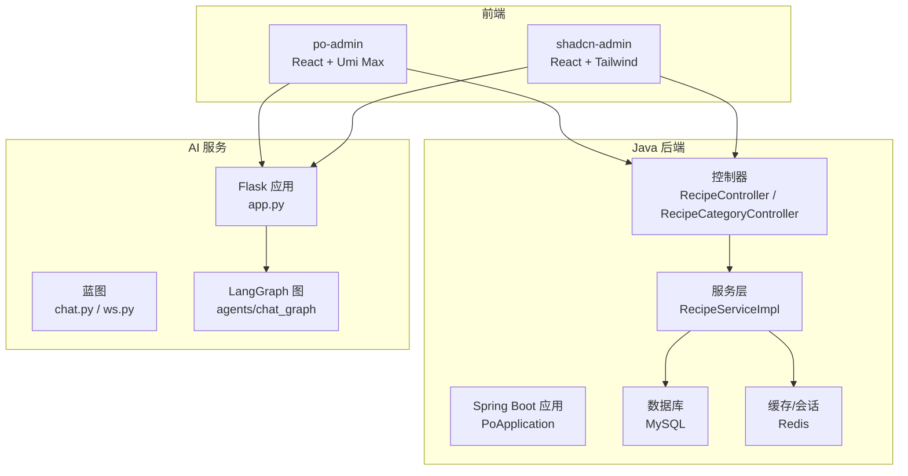
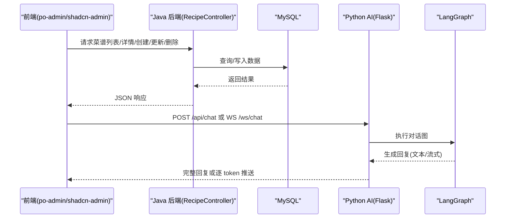
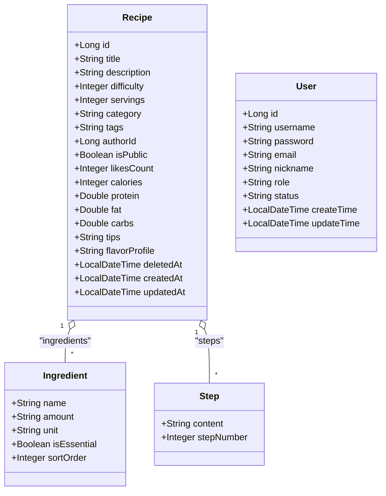
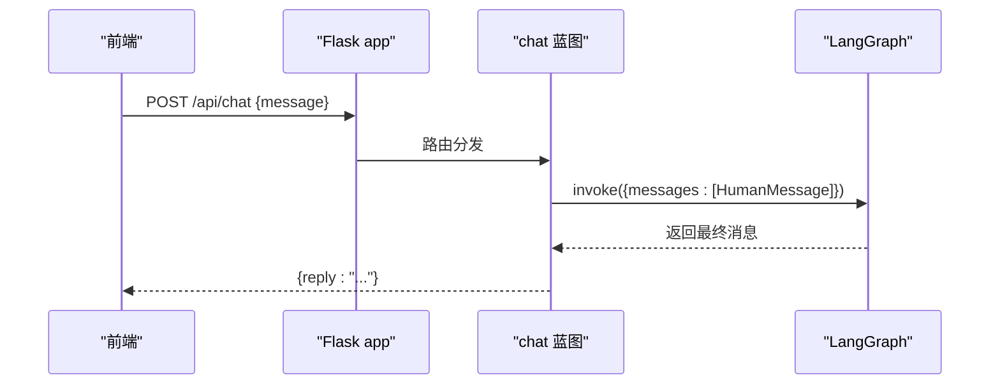
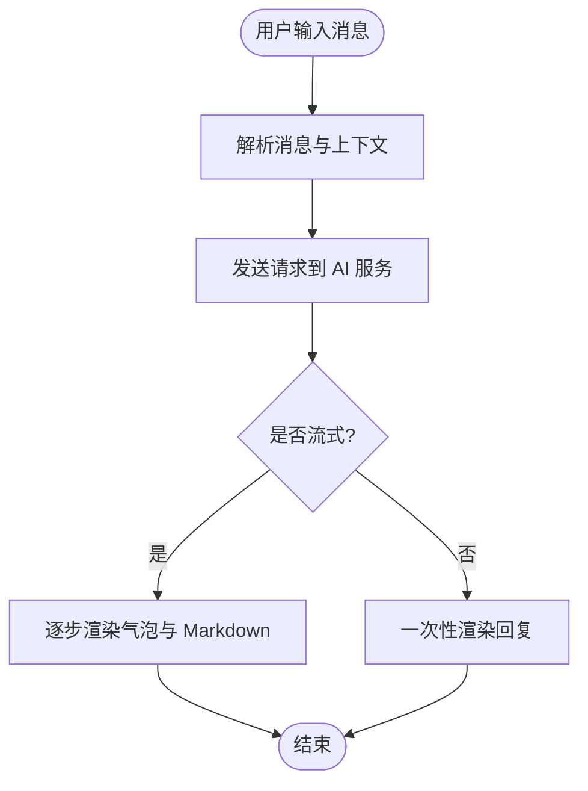
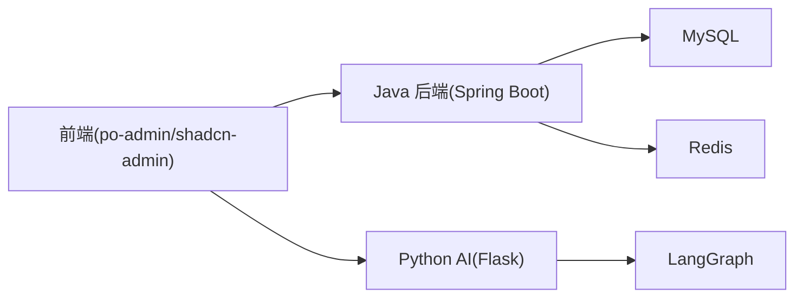

# 项目概述

<cite>
**本文引用的文件**
- [PoApplication.java](file://java_server/po/src/main/java/com/goodzheng/po/PoApplication.java)
- [application.yaml](file://java_server/po/src/main/resources/application.yaml)
- [pom.xml](file://java_server/po/pom.xml)
- [RecipeController.java](file://java_server/po/src/main/java/com/goodzheng/po/controller/RecipeController.java)
- [RecipeCategoryController.java](file://java_server/po/src/main/java/com/goodzheng/po/controller/RecipeCategoryController.java)
- [Recipe.java](file://java_server/po/src/main/java/com/goodzheng/po/entity/Recipe.java)
- [User.java](file://java_server/po/src/main/java/com/goodzheng/po/entity/User.java)
- [RecipeServiceImpl.java](file://java_server/po/src/main/java/com/goodzheng/po/service/impl/RecipeServiceImpl.java)
- [app.py](file://py_server/app.py)
- [chat.py](file://py_server/blueprints/chat.py)
- [config.py](file://py_server/config.py)
- [requirements.txt](file://py_server/requirements.txt)
- [package.json](file://web_client/po-admin/package.json)
- [index.tsx](file://web_client/po-admin/src/pages/chatbot/index.tsx)
- [service.ts](file://web_client/po-admin/src/pages/chatbot/service.ts)
</cite>

## 目录
1. [简介](#简介)
2. [项目结构](#项目结构)
3. [核心组件](#核心组件)
4. [架构总览](#架构总览)
5. [详细组件分析](#详细组件分析)
6. [依赖关系分析](#依赖关系分析)
7. [性能与扩展性](#性能与扩展性)
8. [故障排查指南](#故障排查指南)
9. [结论](#结论)
10. [附录：使用场景示例](#附录使用场景示例)

## 简介
GoodZheng Pro（破）全栈智能菜谱管理系统是一个前后端分离的企业级应用，采用 Spring Boot + Python Flask + React 的混合技术栈。系统提供菜谱的创建、检索、分类管理、用户认证与权限控制等基础能力，并集成基于 LangChain/LangGraph 的 AI 对话服务，支持 REST 一次性回复与 WebSocket 流式回复两种模式。前端基于 Ant Design Pro（Umi Max）构建，具备多语言、主题切换、表格与表单等丰富的企业级 UI 能力；同时包含另一套基于 shadcn-admin 的前端工程用于展示与管理功能。

本项目的核心目标：
- 为厨师、美食爱好者和管理员提供高效的菜谱管理与协作平台
- 通过 AI 助手实现智能问答、菜谱生成建议、步骤优化等功能
- 以清晰的分层架构与模块化设计保障可维护性与可扩展性

## 项目结构
仓库采用多模块组织：
- java_server：Spring Boot 后端，负责业务逻辑、数据持久化、鉴权与对外 API
- py_server：Python Flask 后端，提供 AI 对话服务（REST 与 WebSocket），基于 LangChain/LangGraph 编排 LLM 调用
- web_client：前端工程，包含两个子工程
  - po-admin：基于 Ant Design Pro 的管理后台与聊天界面
  - shadcn-admin：基于 shadcn/ui 的另一套管理界面（含菜谱功能页）

图表来源
- [PoApplication.java:1-14](file://java_server/po/src/main/java/com/goodzheng/po/PoApplication.java#L1-L14)
- [RecipeController.java:18-119](file://java_server/po/src/main/java/com/goodzheng/po/controller/RecipeController.java#L18-L119)
- [RecipeServiceImpl.java:19-37](file://java_server/po/src/main/java/com/goodzheng/po/service/impl/RecipeServiceImpl.java#L19-L37)
- [app.py:24-47](file://py_server/app.py#L24-L47)
- [chat.py:1-24](file://py_server/blueprints/chat.py#L1-L24)

章节来源
- [PoApplication.java:1-14](file://java_server/po/src/main/java/com/goodzheng/po/PoApplication.java#L1-L14)
- [application.yaml:1-109](file://java_server/po/src/main/resources/application.yaml#L1-L109)
- [package.json:1-132](file://web_client/po-admin/package.json#L1-L132)

## 核心组件
- Java 后端（Spring Boot）
  - 启动入口：PoApplication
  - 控制器：RecipeController、RecipeCategoryController
  - 实体：Recipe、User、Ingredient、Step、RecipeCategory
  - 服务：RecipeServiceImpl、RecipeCategoryServiceImpl
  - 配置：application.yaml（端口、上下文路径、JPA、Redis、Actuator、JWT）
  - 依赖：MyBatis-Plus、Spring Data JPA、Redis、JWT、Validation、Security Crypto、Prometheus 监控

- Python AI 服务（Flask）
  - 应用工厂：create_app（注册蓝图、CORS、WebSocket、预热 LangGraph）
  - 蓝图：chat（REST）、ws（WebSocket）
  - 配置：config.py（HOST、PORT、DEBUG、OpenAI 兼容接口参数）
  - 依赖：Flask、Flask-Sock、Flask-CORS、LangChain、LangGraph、python-dotenv

- 前端（React）
  - po-admin：Ant Design Pro，聊天页面 chatbot/index.tsx，服务封装 service.ts
  - shadcn-admin：菜谱功能页与数据交互（recipes 特性）

章节来源
- [RecipeController.java:18-119](file://java_server/po/src/main/java/com/goodzheng/po/controller/RecipeController.java#L18-L119)
- [Recipe.java:10-92](file://java_server/po/src/main/java/com/goodzheng/po/entity/Recipe.java#L10-L92)
- [User.java:8-58](file://java_server/po/src/main/java/com/goodzheng/po/entity/User.java#L8-L58)
- [RecipeServiceImpl.java:19-37](file://java_server/po/src/main/java/com/goodzheng/po/service/impl/RecipeServiceImpl.java#L19-L37)
- [app.py:24-47](file://py_server/app.py#L24-L47)
- [chat.py:1-24](file://py_server/blueprints/chat.py#L1-L24)
- [config.py:10-25](file://py_server/config.py#L10-L25)
- [index.tsx:116-333](file://web_client/po-admin/src/pages/chatbot/index.tsx#L116-L333)
- [service.ts:1-19](file://web_client/po-admin/src/pages/chatbot/service.ts#L1-L19)

## 架构总览
系统采用“前后端分离 + AI 服务解耦”的架构：
- 前端通过 HTTP 访问 Java 后端的菜谱相关 API，进行 CRUD、分页、搜索与权限控制
- 前端通过 HTTP/SSE 或 WebSocket 访问 Python AI 服务，获得智能问答与内容生成
- Java 后端通过 JPA/MyBatis-Plus 操作 MySQL，使用 Redis 做缓存与会话辅助
- Python 服务通过 LangGraph 编排 LLM 调用，支持 OpenAI 兼容接口（可替换为 DeepSeek、通义千问等）

图表来源
- [RecipeController.java:28-119](file://java_server/po/src/main/java/com/goodzheng/po/controller/RecipeController.java#L28-L119)
- [app.py:24-47](file://py_server/app.py#L24-L47)
- [chat.py:10-24](file://py_server/blueprints/chat.py#L10-L24)

## 详细组件分析

### Java 后端：菜谱管理
- 控制器职责
  - 接收请求、校验参数、解析 JWT 获取用户 ID、调用服务层、统一返回 Result
  - 支持按关键词搜索、按分类过滤、分页排序
- 实体模型
  - Recipe：标题、描述、封面、时间、难度、人数、分类、标签、作者、公开状态、点赞数、营养信息、提示、风味、软删除、时间戳；关联 Ingredient 与 Step
  - User：用户名、密码、邮箱、昵称、头像、姓名、电话、角色、状态、时间戳
- 服务层
  - RecipeServiceImpl：事务性创建菜谱，映射 DTO 到实体，处理食材与步骤集合
- 配置
  - application.yaml：端口 8080，上下文 /api，JPA 自动建表，Redis 连接，Actuator 暴露健康与指标，JWT 密钥与过期时间

图表来源
- [Recipe.java:10-92](file://java_server/po/src/main/java/com/goodzheng/po/entity/Recipe.java#L10-L92)
- [User.java:8-58](file://java_server/po/src/main/java/com/goodzheng/po/entity/User.java#L8-L58)

章节来源
- [RecipeController.java:18-119](file://java_server/po/src/main/java/com/goodzheng/po/controller/RecipeController.java#L18-L119)
- [RecipeServiceImpl.java:19-37](file://java_server/po/src/main/java/com/goodzheng/po/service/impl/RecipeServiceImpl.java#L19-L37)
- [application.yaml:1-109](file://java_server/po/src/main/resources/application.yaml#L1-L109)

### Python AI 服务：对话与流式输出
- 应用工厂 create_app
  - 初始化 Flask、注册蓝图（main、chat、ws）、启用 CORS、初始化 WebSocket、预热 LangGraph 图
- 蓝图 chat
  - POST /api/chat：接收消息，调用 get_chat_graph() 执行图，返回完整回复
- 配置 config
  - HOST、PORT、DEBUG、OPENAI_API_KEY、OPENAI_BASE_URL、OPENAI_MODEL
- 依赖 requirements
  - Flask、Flask-Sock、Flask-CORS、LangChain、LangGraph、python-dotenv

图表来源
- [app.py:24-47](file://py_server/app.py#L24-L47)
- [chat.py:10-24](file://py_server/blueprints/chat.py#L10-L24)
- [config.py:10-25](file://py_server/config.py#L10-L25)

章节来源
- [app.py:1-51](file://py_server/app.py#L1-L51)
- [chat.py:1-24](file://py_server/blueprints/chat.py#L1-L24)
- [requirements.txt:1-13](file://py_server/requirements.txt#L1-L13)

### 前端：聊天与菜谱管理
- po-admin 聊天页面
  - 使用 @ant-design/x 提供的 Bubble、Conversations、Sender、XMarkdown 等组件
  - 通过 useXChat 与 OpenAIChatProvider 发起 SSE 流式请求
  - 支持多会话、思考过程显示（Think）、打字机效果
- 服务封装
  - createChatProvider：基于 XRequest 配置模型与流式参数
- 菜谱管理（shadcn-admin）
  - 使用 TanStack Query 管理服务端状态，分页、筛选、搜索
  - 与 Java 后端 API 对接，完成菜谱数据的增删改查

图表来源
- [index.tsx:116-333](file://web_client/po-admin/src/pages/chatbot/index.tsx#L116-L333)
- [service.ts:1-19](file://web_client/po-admin/src/pages/chatbot/service.ts#L1-L19)

章节来源
- [index.tsx:116-333](file://web_client/po-admin/src/pages/chatbot/index.tsx#L116-L333)
- [service.ts:1-19](file://web_client/po-admin/src/pages/chatbot/service.ts#L1-L19)
- [package.json:1-132](file://web_client/po-admin/package.json#L1-L132)

## 依赖关系分析
- Java 后端依赖
  - Spring Boot Web、Data JPA、MyBatis-Plus、Redis、JWT、Validation、Security Crypto、Actuator、Prometheus
  - 通过 application.yaml 配置数据源、JPA、Redis、日志与监控
- Python AI 服务依赖
  - Flask、Flask-Sock、Flask-CORS、LangChain、LangGraph、python-dotenv
  - 通过 config.py 读取环境变量，支持 OpenAI 兼容接口
- 前端依赖
  - React、Ant Design Pro、Umi Max、TanStack Query、Tailwind、Biome、Vitest

图表来源
- [pom.xml:32-115](file://java_server/po/pom.xml#L32-L115)
- [requirements.txt:1-13](file://py_server/requirements.txt#L1-L13)
- [package.json:37-92](file://web_client/po-admin/package.json#L37-L92)

章节来源
- [pom.xml:1-163](file://java_server/po/pom.xml#L1-L163)
- [requirements.txt:1-13](file://py_server/requirements.txt#L1-L13)
- [package.json:1-132](file://web_client/po-admin/package.json#L1-L132)

## 性能与扩展性
- 并发与线程池
  - Tomcat 最大线程数与连接数在 application.yaml 中配置，适合中等规模并发
- 数据库与缓存
  - JPA/Hibernate 自动建表与 SQL 打印便于开发调试；Redis 可用于热点数据缓存与会话存储
- AI 服务
  - 支持流式输出提升用户体验；可通过环境变量切换不同 LLM 提供商
- 前端
  - 使用 TanStack Query 与服务端状态同步，减少重复请求；SSE 流式渲染降低首屏等待

[本节为通用指导，不直接分析具体文件]

## 故障排查指南
- Java 后端
  - Actuator 暴露 health、info、metrics、prometheus，便于健康检查与指标采集
  - 日志级别与输出路径在 application.yaml 中配置，便于定位问题
- Python AI 服务
  - chat 蓝图捕获异常并记录日志，返回错误信息；可通过环境变量开启 DEBUG
- 前端
  - 使用 Biome 进行代码检查，Vitest 进行单元测试；网络请求失败时可通过浏览器开发者工具查看

章节来源
- [application.yaml:68-95](file://java_server/po/src/main/resources/application.yaml#L68-L95)
- [chat.py:17-24](file://py_server/blueprints/chat.py#L17-L24)
- [package.json:13-32](file://web_client/po-admin/package.json#L13-L32)

## 结论
GoodZheng Pro 通过清晰的三层架构与模块化设计，实现了菜谱管理的核心业务与 AI 对话能力的有机结合。Java 后端负责稳定可靠的数据服务与权限控制，Python AI 服务提供灵活的智能问答与内容生成，前端则提供现代化的交互体验。该架构具备良好的扩展性，能够平滑接入更多 AI 模型与前端功能模块。

[本节为总结性内容，不直接分析具体文件]

## 附录：使用场景示例
- 菜谱管理
  - 管理员登录后可创建菜谱，填写标题、描述、难度、分类、标签、食材与步骤；支持按关键词与分类分页检索
  - 普通用户可查看公开菜谱，评论与收藏（如需扩展）
- AI 对话
  - 用户在聊天页面输入“如何制作一道低脂红烧肉”，AI 返回步骤与建议；支持流式输出与思考过程展示
  - 开发者可通过环境变量切换 LLM 提供商，适配不同业务需求

[本节为概念性说明，不直接分析具体文件]