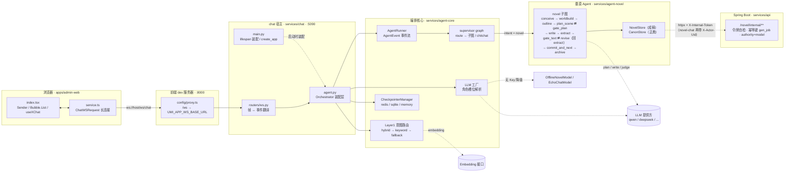
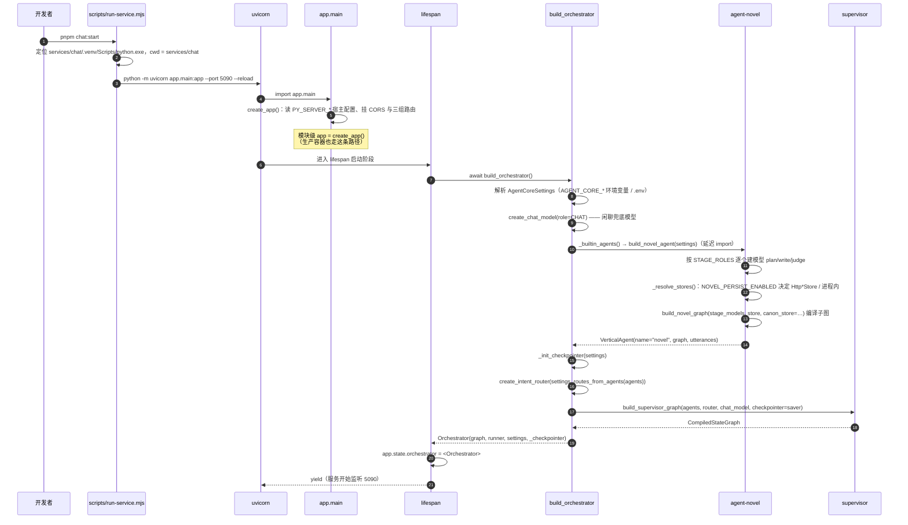
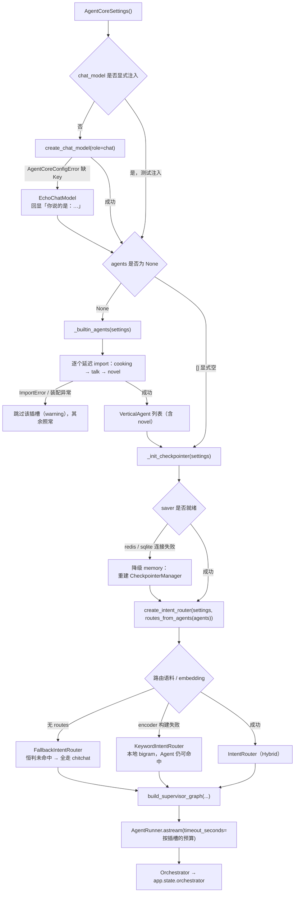
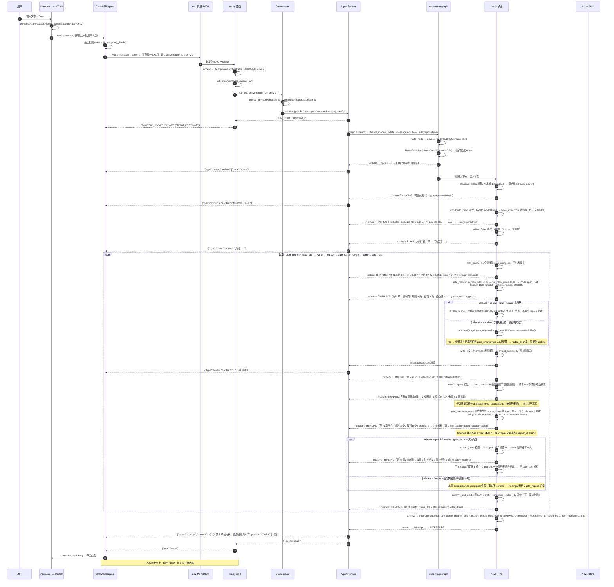
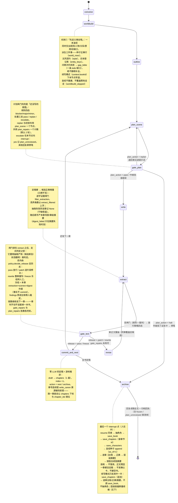
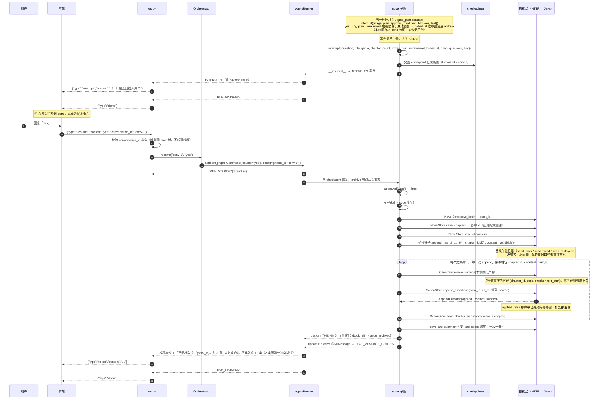
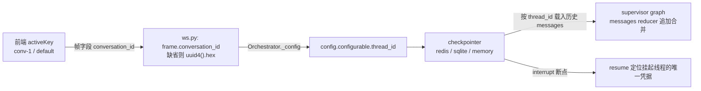

# novel Agent 全链路图：启动 → 运行 → 客户端往返

一张图看懂 novel Agent 从**进程启动**到**一次对话往返**的完整路径，包含三部分：

| 视角 | 回答的问题 | 对应章节 |
| --- | --- | --- |
| 启动装配 | 谁在什么时候把什么装进 Orchestrator？失败会怎样？ | [第 2 章](#2-启动装配链路) |
| 运行期 | 一条消息如何穿过 supervisor 进到 novel 子图，再变回浏览器里的字？ | [第 3 章](#3-运行期链路一条-message-帧的往返) |
| 往返约束 | interrupt/resume 为什么必须等 `done`？哪些节点会重跑？ | [第 4 章](#4-interrupt--resume-往返) |

> 图中所有节点名、帧名、字段名均取自当前代码；改了这些名字等于改了协议或前端展示口径。

---

## 0. 坐标：这份图涉及哪些文件

| 层 | 文件 | 职责 |
| --- | --- | --- |
| 浏览器 | `apps/admin-web/src/pages/chatbot/index.tsx` | 页面：`Sender` 输入、`Bubble.List` 渲染、`useXChat` 会话状态 |
| 浏览器 | `apps/admin-web/src/pages/chatbot/service.ts` | WS 客户端：`ChatWSRequest` 长连接、`run/flush` 发送、帧分发 |
| 前端 dev | `apps/admin-web/config/proxy.ts` | `/api/` → REST 后端；`/ws` → WS 后端（`ws: true`，仅开发态） |
| 浏览器 | `apps/admin-web/src/pages/novel/studio/useNovelRun.ts` | 生成链路的 WS 通道：五态机（connecting/running/awaiting/finished/failed）、`interrupt` 载荷、`answer()` 的排队补发、`start(content, context?)` 的运行控制键 |
| 浏览器 | `apps/admin-web/src/pages/novel/studio/RunPanel.tsx` | 生成面板（顶栏「AI 创作」抽屉）：续写本书 / 写本新书两个入口 +「写之前先问我」+ 两处人工口的卡片 |
| 浏览器 | `apps/admin-web/src/pages/novel/studio/chapterRange.ts` | 「第 X 至 Y 章」中文范围解析 + 与服务端同源的收敛预告（`resolveContinueRun`） |
| 协议类型 | `packages/types/src/chat.ts` | `ChatInFrame` / `ChatWSFrame` 的前端侧类型收口 |
| chat 宿主 | `services/chat/app/main.py` | 应用工厂 + lifespan：装配 Orchestrator、注册路由、关闭时释放连接 |
| chat 宿主 | `services/chat/app/routers/ws.py` | **唯一的协议翻译层**：入站帧校验 → `Orchestrator` → `AgentEvent` → 出站帧 |
| chat 宿主 | `services/chat/app/agent.py` | **装配层**：模型 / checkpointer / 路由 / 垂直 Agent 的选择与全部降级 |
| chat 宿主 | `services/chat/app/schemas.py` | `WSInFrame` / `WSOutFrame`（Pydantic V2） |
| 编排核心 | `services/agent-core/src/po_agent_core/runner/runner.py` | `AgentRunner`：LangGraph 流 → 统一 `AgentEvent` 流 |
| 编排核心 | `services/agent-core/src/po_agent_core/events.py` | `EventType` / `AgentEvent` 契约（**唯一真相**） |
| 编排核心 | `services/agent-core/src/po_agent_core/supervisor/graph.py` | supervisor：`route` → 垂直子图 / `chitchat` |
| 编排核心 | `services/agent-core/src/po_agent_core/routing/router.py` | Layer1 意图路由 + 两级降级链 |
| 编排核心 | `services/agent-core/src/po_agent_core/memory/checkpointer.py` | 三策略 checkpointer（redis / sqlite / memory） |
| 编排核心 | `services/agent-core/src/po_agent_core/llm/factory.py` | 角色槽位 → 模型实例（分阶段模型的落点） |
| 垂直 Agent | `services/agent-novel/src/po_agent_novel/agent.py` | 插槽装配：`NOVEL_UTTERANCES` + 分阶段模型 + 数据层推导（`NOVEL_PERSIST_ENABLED`） |
| 垂直 Agent | `services/agent-novel/src/po_agent_novel/graph.py` | 子图本体：十一节点 + 四条条件边 + 两处 interrupt；模块级 `bible_extraction`（圣经 → 种子正典）、`gap_bible`（世界问不出时的可见缺口）、`_arc_spans`（弧切分） |
| 垂直 Agent | `services/agent-novel/src/po_agent_novel/context.py` | **L1 记忆装配**：四层预算 + `[canon#N]` 编号 + as-of 取数 + 裁剪。每章**两次**：`plan_scene` 前全量（`plan_compiled`）、`write` 前按场景卡 `entities` 收窄（`context_compiled`）；产物带 `snapshot/refs/style` 给闸门（`ns["plan_view"]` / `ns["gate_view"]`） |
| 垂直 Agent | `services/agent-novel/src/po_agent_novel/gates.py` | **确定性规则闸门**（§9.1）：正文侧七条 + 计划侧四条（`run_plan_rules`），都是零 LLM 规则 + **同一个** `validate_findings` 验收口 + `_cap_per_code` → `GateReport`。机制②的逐字口径 `evidence_verbatim` 与 `locate_quote`（证据→span）也住这里，前者被 `graph.filter_extraction` 复用。消费者是 `gate_text` 与 `gate_plan` 两个节点 |
| 垂直 Agent | `services/agent-novel/src/po_agent_novel/judge.py` | **语义裁判**（§9.2）：`judge_prompt`（正文）与 `plan_judge_prompt`（场景卡）→ `FindingList`，两路产物过**同一个** `validate_findings`；`checker` 强制归位、span 由证据反推、四类丢弃计数、`failed` 与「查不出」分开 |
| 垂直 Agent | `services/agent-novel/src/po_agent_novel/policy.py` | **放行策略**（§9.3）：正文侧 `decide_release` 折成 pass/patch/rewrite/freeze，计划侧 `decide_plan_release` 折成 pass/replan/escalate（**major 在计划侧即必修**）；附 `conflicting_keys`（major → `disputed`）、`patch_plan`（降序片段 + `overflow`）、`splice_patch`（长度护栏）、`rewrite_feedback`。零 LLM 零网络，消费者是 `gate_text` / `revise` / `gate_plan` |
| 垂直 Agent | `services/agent-novel/src/po_agent_novel/store.py` | 数据层协议（`NovelStore` 成稿 / `CanonStore` 正典）+ 进程内实现 |
| 垂直 Agent | `services/agent-novel/src/po_agent_novel/http_store.py` | HTTP 实现：打 Java `/novel/internal/**`，重试 + `Result` 信封解包 |
| 垂直 Agent | `services/agent-novel/src/po_agent_novel/prompts.py` | 提示词模板 + `PROMPT_VERSION`（幂等键的一维）；`scene_card_text` 是场景卡的**稳定渲染**，计划闸门三方（规则 / 裁判 / escalate 卡片）共用的唯一坐标系 |
| 垂直 Agent | `services/agent-novel/src/po_agent_novel/offline.py` | 无 Key 时的离线模型（确定性占位，标注 `【离线模式】`） |
| 测试语料 | `services/agent-novel/tests/golden/{book,score}.py` + `tests/test_golden.py` | **一致性黄金集**（PRD §12.1）：一部 20 章的带毒书 + 20 张场景卡，标注用 `parts` 下标指认逐字片段，因此「标注说什么」与「正文写什么」不可能分家。打分器只打三面可确定的判据（规则闸门 / 逐字证据闸门 / 别名唯一索引），闸门输入一律由 `context.compile_context` 现装配（注入视图与判定视图同源）；四类只有裁判能判的编码不进召回分母，改由覆盖台账钉住 |
| 后端 | `services/api/novel/.../controller/NovelInternalController.java` | 内部写入通道（`/novel/internal/**`）：令牌自检 + 成稿/正典写入 + as-of 快照 |

---

## 1. 全景图

一次问答牵动的全部角色与连线（不含 A2A/MCP，属 P3/P4 规划）：

**读图要点**

- 浏览器只认识**帧**（JSON），不认识事件、节点、模型：跨层契约只有两个 —— 入站 `message|ping|resume`，出站 13 种帧（见 §3.3）。
- `agent.py` 是唯一的「决策集中点」：模型、路由、checkpointer、垂直 Agent 的每一种失败都在这里被换算成某条降级路径，上层（WS/前端）零感知。
- 子图到 LLM 的三条虚线对应三种角色（plan/write/judge）——**同一张图可以有多个模型**，见 §2.3。
- 数据层到 Spring Boot 那条虚线是**唯一**的写库路径，且只在用户对 `interrupt` 答 `yes` 之后才走（时序见 §4.1）；本地直连 8080，容器里由 `NOVEL_API_BASE_URL` 改成内部服务名。

---

## 2. 启动装配链路

### 2.1 启动时序

从敲下命令到「可以收 WS 连接」为止发生的事：

**配置从哪来**：`AgentCoreSettings`（前缀 `AGENT_CORE_`，`services/agent-core/.../config.py`）与宿主 `Settings`（前缀 `PY_SERVER_`，`services/chat/app/config.py`）都读**进程 cwd 下的 `.env`**，同时接受真实环境变量；本地开发 cwd 是 `services/chat`，仓库根 `.env` 供 docker compose 使用。两者刻意分家：宿主参数（host/port/CORS）与编排参数（Key/checkpointer/路由）不混在一个 Settings 里。

### 2.2 `build_orchestrator` 逐段拆解

`services/chat/app/agent.py`，四步固定顺序，每步都有自己的降级出口：

### 2.3 novel Agent 装配：分阶段模型

novel 子图的节点在**装配期**按 `NODE_MODEL_ROLES` 声明的角色取模型（`graph.py`），运行期不再查表 —— 换模型 = 改配置 + 重启。

| 节点 | 角色 | 干什么 | 建议模型画像 |
| --- | --- | --- | --- |
| `conceive` | `plan` | 一句话 → 书名/题材/梗概（结构化） | 便宜、够聪明 |
| `worldbuild` | `plan` | 书级圣经：规则/人物/关系/禁用词/缺口（结构化），同时落成种子正典与文风契约 | 同上；问两次仍失败即退化为「一条 todo 缺口」并留痕 |
| `outline` | `plan` | 全书章节规划（结构化，含章标题/梗概/弧名） | 同上（同一颗「规划脑」） |
| `plan_scene` | `plan` | 单章场景卡：entities / newEntities / scenes(present, beats) / mustChange / payoffs / 字数带 | 同上；初排与 replan 共用本节点，靠 `plan_feedback` 区分 |
| `gate_plan` | `judge` | 计划闸门：`run_plan_rules` + `run_plan_judge` → `decide_plan_release` 三态 | 与 `plan_scene`/`write` **异源**：它审的是「照这张卡写会不会出事」，与写作那颗脑判断维度重叠时两道闸门会一起瞎 |
| `write` | `write` | 章节正文初稿，**token 流式** | 贵、长文质量决定体验 |
| `revise` | `write` | 定向修补 / 整章重写（非流式，只回正文） | 同 `write` 槽位：换一颗脑 = 换一种语气，黄金集就无法比对同一处的前后两版 |
| `extract` | `plan` | 从定稿章抽候选正典增量（断言/状态/称谓/伏笔，结构化）+ 本章场景/章级摘要 | 与两道裁判**刻意分角色**：抽取者与被审者同源会有盲区一致性 |
| `gate_text` | `judge` | 语义裁判（结构化 `FindingList`）+ 规则闸门同节点顺序执行，产物交 `policy.decide_release` 定放行结论 | 必须与 `write` **异源**：写手与裁判同一颗脑时，§9.2 的互查退化成自我确认 |
| `commit_and_next` | —— | **零 LLM**：定稿、推进游标、决定「下一章还是收尾」 | 不在 `NODE_MODEL_ROLES` 里：给它声明角色只会在装配期多建一颗模型，并让人以为定稿有模型参与 |
| `archive` | `judge` | 角色抽取（结构化） | 同 `judge` 槽位 |
| `archive` 末尾的弧摘要 | `plan` | 按 `_arc_spans` 的跨度合成弧级摘要 | 同 `plan` 槽位 |

`STAGE_ROLES = ("plan", "write", "judge")` 即去重后的所需角色集合，装配层逐个建模型：

**三条安全规则（都是刻意的）**

1. **不配就是单模型**：`llm_roles` 为空时三个角色全部回落 `AGENT_CORE_LLM_*`，行为与单模型时代一致，前端/测试零感知。
2. **跨 provider 不复用密钥**：某角色声明的 `provider` 与全局 `llm_provider` 不同时，**不继承**默认槽位的 model / base_url / api_key，缺 Key 直接报错并点名 `AGENT_CORE_LLM_ROLES__JUDGE__API_KEY` —— 否则会把 A 家的 Key 发给 B 家。
3. **整体离线，不做混合链路**：任一角色解析失败，`_build_stage_models` 把**所有**角色换成 `OfflineNovelModel`。这避免了「真模型写正文 + 占位模型审稿」这种既不省钱又难排查的中间态。

关键词大小写不敏感、开放词汇：`AGENT_CORE_LLM_ROLES__WRITE__MODEL` 与 `...__write__model` 等价；角色名不必是枚举成员，但推荐用 `chat`/`plan`/`write`/`judge`。

### 2.4 装配期失败 → 降级点

启动永不因配置失败而中断，所有降级都在这一层收敛：

| 失败点 | 降级动作 | 用户可见现象 | 代码位置 |
| --- | --- | --- | --- |
| LLM 缺 Key | `EchoChatModel` | 闲聊回「你说的是：…」 | `chat/app/agent.py` |
| novel 包缺失/装配异常 | 跳过该插槽 | 小说意图走 chitchat 兜底 | `chat/app/agent.py` `_builtin_agents` |
| 任一阶段角色不可用 | 全角色 `OfflineNovelModel` | 正文带 `【离线模式】`，圣经恒 `todo` 缺口、场景卡不挑实体、裁判恒空集（**不是「审查通过」**） | `agent-novel/agent.py` |
| checkpointer 连不上 | memory（进程内） | 重启即失忆、多 worker 不共享 | `chat/app/agent.py` `_init_checkpointer` |
| 无路由语料 | `FallbackIntentRouter` | 全部走 chitchat | `routing/router.py` |
| embedding 缺 Key / 装配失败 | `KeywordIntentRouter` | 垂直 Agent 仍可被命中 | `routing/router.py` |
| 世界构建问不出结果（违约 / 网络） | 重问 1 次仍失败 → 退化成**只含一条 `todo` 缺口**的圣经，后续章节照常写 | `worldbuild_failed` 帧 + `worldbuilt` 的 `degraded: true`，归档卡片 `open_questions` 带失败原因 | `agent-novel/graph.py` `worldbuild_node` / `gap_bible` |
| 计划冲突两轮改不平 / 计划裁判失败 | `escalate` → `gate_plan` 内 interrupt 交作者：yes 继续写并记 `plan_unreviewed`，其他回复即停笔进归档 | 「第 N 章的场景卡有 k 条未平的冲突…照这张卡继续写请回复 yes」 | `agent-novel/graph.py` `gate_plan_node` |
| 正典抽取失败（模型违约 / 网络） | 该章记 `None`、不 commit 新事实，其余章与归档照常 | `thinking` 帧「第 N 章正典抽取失败…（待人工补录）」 | `agent-novel/graph.py` `extract_node` |
| 成稿入库失败（重试已用尽） | 正文照回，正典不写（重投不会双写） | 「入库失败（…），请稍后重试归档」 | `agent-novel/graph.py` `archive_node` |
| 单章正典入库失败 | 不终止归档（成稿已落库），失败章进 `canon_failed` 待重驱 | 回执尾部「第 X 章入库失败，待重驱」 | `agent-novel/graph.py` `write_canon` |

---

## 3. 运行期链路：一条 `message` 帧的往返

### 3.1 全时序

以「帮我写一本玄幻小说」为例，从键盘到屏幕的完整往返：

`done` 之前的每一帧都是**信息性**的：只有 `token` 累积成气泡内容，`done`/`error` 才是终止事件。

### 3.2 novel 子图内部状态机

supervisor 把 novel 子图**当作一个节点**挂载（`builder.add_node("novel", agent.graph)`），子图内部的节点会以 `STEP` 事件上浮（靠 `subgraphs=True`）。

**续写模式（`context.bookId` 存在 ⇒ `mode="continue"`）**：`conceive` 不再问模型构思，而是把库里已有的这本书读回成状态起点——`index` 播种为「**有正文的章数**」（`chapter_count`，不是章节行数：管理端允许排一行标题与正文都空的「待写占位」，它算排期而不算写过，见 PRD §15.23），于是 as-of、`outline[index]`、`ChapterDraft(index=index+1)` 三处编号语义一行都不用改；已定稿章在 `outline` 里只以占位条目存在（对齐序号用，标题写死「已定稿，不在本轮」，`summary` 不能为空串否则整张列表构造即 ValidationError）。本轮 `chapters` 只装新章，而 `save_chapters` 的语义是**按章号落位**：那一行若还空着（作者排的待写占位）就被本轮正文就地填掉且**行 id 不变**（正典断言按 `chapter_id` 溯源），已有正文则整轮报错而不静默覆盖——**这条链路的续写是 append-only，覆盖已定稿正文从来不是选项**，作者要的范围若已写完就往后收敛。四个控制键（`fromChapter/chapterCount/auto/tailChapterId`）走 `configurable.context` 而不是提示词前缀，宿主侧已把它们列为保留键（`services/chat/app/agent.py`）。三处不做的：`worldbuild` 早退、`save_book` 不调、角色抽取不调（`bible is None` 时圣经 seed 也自动跳过）。一处特别的：`write_canon(continuation_of=written)`——弧级是**唯一会改写已有行**的层（Java 按 `(book, level='arc', 弧号)` upsert），所以先读既有最大弧号当偏移，读不到就整段不写弧并把这句写进归档回执；其余层用全局章号，天然无需偏移。续写第一章的衔接原文从库里读回（`ns["prev_tail"]` → `compile_context(prior_tail=...)`），因为 Tier-2 的尾段取自本轮 `chapters`，本轮此时还是空的；`prev_tail` 只在那一章的章号恰等于游标时才采信，指向待写占位（空正文）一律读成「没有尾段」。`auto` 为真时 `gate_plan` 与 `archive` 的 `interrupt` 都不挂起（按 `"yes"` 走），闸门本身照跑、未审计划仍记进 `plan_unreviewed`；续写默认 `auto=True`，新书默认 `False`。

**每章两次装配**：`plan_scene` 前一次（`entities=None`，全量 as-of 快照——计划闸门要看得见全部登记事实才判得出「这个 key 没登记过」），`write` 前一次（按场景卡的 `entities` 收窄，`entities` 为空则同样退回全量）。as-of = 当前章下标。装配失败不阻断写作——本节宁可不带正典，也不能让整条链路停在一次库读上；但那必须留痕（`context_failed` / `plan_context_failed`），否则事后无法把设定漂移定位到某一章。

**领域状态全部在 `CoreState.artifacts["novel"]` 命名空间**（supervisor 不解释）：

| 组 | 键 | 说明 |
| --- | --- | --- |
| 书级 | `brief / idea / bible / world_rows / style / outline / entity_keys` | `world_rows` 是圣经派生的读侧断言行（进 Tier-0），`entity_keys` 是登记表 = 圣经键 ∪ 历轮抽取键，回灌给 `plan_scene` 的可选清单与抽取提示词以压制「同一人物第二个 key」 |
| 模式 | `mode / auto / start_chapter / new_count / existing_chapters / prev_tail / author_note / prior_lines` | `mode` = `new` / `continue`；`auto` 决定两处人工口挂不挂起；`prev_tail` + `prior_lines` 只在续写里有值（上一章尾段、最近 6 条章级摘要），`author_note` = 作者这一句原话，进大纲/场景卡/正文三处提示词 |
| 章节游标 | `chapters / index / draft / action / book_id` | `index` 0 基的「正在写」章（续写时播种为**有正文的章数**，标题正文都空的待写占位不计，见 PRD §15.23）；`draft` 定稿前不进 `chapters` |
| 计划回环 | `plan / plan_view / plan_repairs / plan_feedback / plan_action / plan_stats / plan_unreviewed / plan_new / halted_at` | `plan_stats` 是最近一次计划闸门的判据快照（**只上浮，不落 `review_finding` 表**）；`plan_new` 是卡上自报的新实体，只交给作者，永不进正典 |
| 正文回环 | `extractions / gate_repairs / gate_action / gate_view / frozen` | `extractions` 按章号覆盖，含 `content_hash`、被丢弃条数、`scenes`/`digest` 摘要行、闸门写入的 `gate`/`findings`/`blockers`；`frozen` 累积待人工裁定的章号 |

**两个回环各数各的轮**：`plan_repairs` 判「这张卡改平了没有」，`gate_repairs` 判「闸门点出的那一处改掉没有」，合并计数会造出「计划只改十几行所以便宜得多烧一轮」这种分支；两者都在各自闸门给出终态时归零。旧图的 `revisions`（审稿轮）随 `reflect` 节点一并删除——主观分数不再有任何豁免权。`plan_action` 与 `gate_action` 是两条条件边唯一读的路由键。

**节点 → 模型**：`conceive`/`worldbuild`/`outline`/`plan_scene`/`extract` → plan，`write`/`revise` → write，`gate_plan`/`gate_text`/`archive`（角色抽取）→ judge，`commit_and_next` 不在表里（零 LLM）；摘要与弧摘要跟抽取同颗规划脑（见 §2.3）。裁判与写手**必须异源**：同一颗脑审自己写的东西，§9.2 的互查就退化成自我确认。`revise` 用写作脑而非审稿脑：换一颗脑等于换一种语气，§12 黄金集要比对的正是在**同一颗写作脑**下同一处的前后两版。

**闸门视图不重读库**：`write` 把 `compile_context` 的产物连同 `snapshot`/`refs`/`style` 存进 `ns["gate_view"]`，`gate_text` 只用这一份；`gate_plan` 同理用 `ns["plan_view"]`。节点自己再读一遍会得到一份更宽或更窄的视图，两份之间的差值会被当成冲突报出来，出问题无法归因。装配失败时视图为 `None`：依赖设定的规则各自计入 `skipped`、裁判的证据全部定位失败——是「不可判定」，不是「通过」。

**六个易错点**：子图 `compile()` **不挂 checkpointer**（由父图统一供给，否则会产生第二份状态破坏恢复语义）；`plan_scene` 一处节点同时服务初排与 replan（靠 `plan_feedback` 是否为空分流提示词），`write` 只走初稿一条路径（修补都在 `revise`）；`extract` **不写库**——它拿不到 `book_id` 与章节 id（只在 archive 的 interrupt 之后才存在），而且 resume 重放会把它攒的候选写成双份；**归档前 L1 一次库读都不发生**，本轮事实靠 `overlay`/`digests` 两条内存通道，拿空 `book_id` 去打后端只会得 400；`revise` 只改当前章的正文、既不推进 `index` 也不动 `plan_repairs`，且**必须回 `extract`**（新正文要重抽候选，`_put_entry` 按章号覆盖旧条目）——直连 `gate_text` 会让闸门拿旧正文的逐字偏移去检新稿；`gate_plan` 的 interrupt 排在 `_emit` 之前，所以 resume 会**重放规则 + 裁判这两段**（都是只读的，代价是一次调用），第二次 run 才带出 `plan_gated` 的 `approved` 帧。

**计划 Finding 不落库**：`review_finding` 的 span 语义是「正文字符区间」，而计划闸门的坐标落在 `scene_card_text` 渲染出的卡文本上——写进去会让作者点过去落在正文的别处，悬空出处比少一条记录更有害。它只上浮进 `plan_gated` 事件、`plan_stats` 与归档卡片（PRD §15.6 #7 登记，N5b 工作台要展示它得先决定加列还是另建表）。

### 3.3 事件 → 帧映射

`ws.py` 的 `_EVENT_TO_FRAME` 是**唯一**的翻译表，新增事件必须在这里登记，否则被静默丢弃（内部事件不泄漏给前端）：

| `AgentEvent`（核心） | WS 帧（前端） | `payload` 关键字段 | 来源 |
| --- | --- | --- | --- |
| `RUN_STARTED` | `run_started` | `thread_id` | runner 在进入图之前发 |
| `THINKING` | `thinking` | `stage` / `title` / `chapter` / `score` … | 子图 `_emit` 的 custom 流 |
| `PLAN` | `plan` | `stage: "outlined"` / `chapters` | 同上 |
| `STEP` | `step` | `node`（可能是子图内部节点名） | 每个有更新的节点 |
| `TEXT_MESSAGE_CONTENT` | `token` | `node` | `messages` 流（打字机）或 updates 补发 |
| `TOOL_CALL_START/ARGS/END/RESULT` | `tool_call_*` | `tool_call_id` / `name` / `status` | 工具调用（novel 当前不用工具） |
| `INTERRUPT` | `interrupt` | `value`（完整载荷字典） | `__interrupt__` updates，按 `id` 去重 |
| `PROPOSAL` | `proposal` | `bookId` / `sessionId` / `asOfChapter` / `kind` / `subjectKey` / `predicate` / `objectText` / `validFromChapter` / `basisQuote` | 仅 `novel-chat` 插槽：设定提议卡，前端渲染成「采纳/驳回」，采纳走管理端 REST（`POST /novel/proposals` 落库后 `PUT .../adopt`） |
| `RUN_FINISHED` | `done` | — | runner 收尾 |
| `RUN_ERROR` | `error` | `error_type` / `timeout_seconds` | 超时或异常，**终止帧** |
| `TOOL_APPROVAL_REQUEST` 等 | *（未登记）* | — | 丢弃，留给 P3/P5 审批流 |
| — | `pong` | — | `ping` 帧的直接回应，不经过编排器 |

**为什么是「事件」而不是「帧」**：核心库不认识 WebSocket。A2A SSE（P4）、MCP 通知（P3）将来消费的是**同一条** `AgentEvent` 流，只是换成另一张映射表。

**`payload.stage` 的取值**（前端按它区分进度卡片类型，新增值即改展示口径）：
`conceived` / `worldbuilt` / `worldbuild_failed` / `outlined` / `planned` / `plan_gated` /
`plan_approval`（interrupt 载荷）/ `plan_compiled` / `plan_context_failed` /
`context_compiled` / `context_failed` / `drafted` / `extracted` / `extract_filtered` /
`extract_failed` / `digest_failed` / `gated` / `repaired` / `gate_orphan` /
`chapter_done` / `halted` / `archived` / `archive_failed` / `declined` /
`resumed`（续写起点：带 `book_id` / `from_chapter` / `to_chapter` / `existing_chapters` /
`requested_chapters` / `auto` / `entities` / `has_tail`）/ `worldbuild_skipped`（续写不重建圣经）。
对话面板（`novel-chat` 插槽）另有五条，均以 `chat_` 开头：
`chat_context_compiled`（本轮 L1 装配结果，带 `as_of` / `tokens` / 各级计数——
**N6 的注入 P95 按两条装配路径分开统计，读的就是它与 `context_compiled` 的差**）、
`chat_context_failed`（书目或正典读不回，答复不引用任何已登记设定）、
`chat_proposals`（本轮出卡数与依据对不上的丢弃数）、
`chat_proposal_failed`（抽取失败，本轮无卡）、`chat_prose_refused`（代写守门命中，未调模型）。
除 `chat_prose_refused`（不涉读库、无需归因）外都带 `path: "chat"`，与生成侧的 stage 分流。
其中 `worldbuilt` 带规则/人物/关系/禁用词/未决计数与 `degraded` 布尔，
`planned` 带 `entities` / `new_entities` / `scenes` / `payoffs` / 字数带与 `replan` 布尔，
`plan_gated` 带计划侧全套计数（`rule` / `judge` / `duplicated` / `dropped` / `skipped` /
`judge_failed` / `blockers` / `majors` / `release` / `unreviewed` / `findings`，
escalate 重放那一轮多带 `approved`），
`extracted` 带四类候选条数，`extract_filtered` 带 `dropped` 条数，
`plan_compiled` 与 `context_compiled` 各带 `tokens` 与 `tier1` / `tier2` / `world` /
`dropped` 计数加收窄遥测（`entities` / `narrowed` / `tier1_empty_by_entities`）——
**N6 的成本监控读这两条**，P95 注入 ≤ 4k 的口径就是它们的 `tokens`，
而「按场景卡实体检索命中空集」必须与「这本书真的没有相关设定」区分得开（§8-⑧）；
`gated` 带本章正文双闸门的全套计数
（`rule` / `judge` / `duplicated` / `dropped` / `skipped` / `words` / `blockers` / `majors` /
`disputed` / `judge_failed` / `release` / `unreviewed`，**放行策略与 N6 的 CI 门禁读这条**；
一条修补回环会产出同章的多条 `gated`），`repaired` 带 `action`（patch/rewrite）与
`patched` / `rejected` / `failed` / `overflow` 四个计数（前端即「第 N 章定向修补：改写 a 处 /
拒收 b 处 / 失败 c 处」），`chapter_done` 带本章的 `release` / `frozen` / `advanced`，
`halted` 是「开篇那张卡就被判停、全书零定稿」的痕迹（此时不发确认卡也不建空书），
`gate_orphan` 是链路自检异常（本章缺 extract 条目）的痕迹，
`archived` 带正典统计 `canon_inserted` / `canon_skipped` / `canon_replayed` / `canon_failed`
与 `seed_rows` / `seed_failed` / `seed_replayed`（圣经基线单独记账：没有基线，
后面每一章的比对口径都悄悄变松了）、
摘要统计 `summary_rows` / `arc_count`、台账统计 `finding_rows` / `findings_failed`、
冻结章清单 `frozen` 与计划侧留痕 `plan_unreviewed`（回执文本另带
`unreviewed_note` / `halted_note`，`halted_at` 只在归档确认卡片的载荷里）。

### 3.4 前端各帧的处理

两套前端在同一条 `/ws/chat` 上：chatbot 页（`apps/admin-web/src/pages/chatbot/service.ts`，走 x-sdk 壳）与
创作工作台右栏（`apps/admin-web/src/pages/novel/studio/useNovelChat.ts`，自己读帧）。
第三个消费者是工作台顶栏「AI 生成」抽屉（`apps/admin-web/src/pages/novel/studio/useNovelRun.ts`，`agent:'novel'`）：
它是唯一会答 `interrupt` 的一路，帧的取用与 resume 时序见 §4.3。

| 收到帧 | chatbot 页 | 工作台右栏（`agent:'novel-chat'`） |
| --- | --- | --- |
| `token` | 推入 `chunks`，`onUpdate` → `transformMessage` 追加内容 → 气泡打字机 | 追加到当前 assistant 轮正文 |
| `done` | `requesting = false`，`onSuccess(chunks)` → 气泡定型 | 清 `assistantRef`、`requesting = false` |
| `error` | `requesting = false`，`onError(content)` | 同上 + 底部 `Alert`（可关） |
| `pong` | 直接 return（心跳） | 直接 return（心跳） |
| `thinking` / `plan` | **信息性透传**：忽略 | 推入 `turn.notes`，收成「过程 N 条」的 Tooltip——装配失败、出卡数这类断链痕迹要看得见（§12.2） |
| `proposal` | **信息性透传**：忽略 | 推入 `turn.cards`（本地 `card-N` 键），渲染 `ProposalCard`：采纳/驳回都走 REST，前端不拼装 `ProposalRequest` 之外的字段 |
| `run_started` / `step` / `tool_call_*` / `interrupt` | **信息性透传**：忽略 | 忽略（右栏只谈不写，没有审批流可挂；生成链路的两个人工口见 §4.3） |

心跳：连接建立后每 30s 发 `{"type":"ping"}`，服务端回 `pong`，不触碰编排器。
未知 `type` 两侧都必须落到「忽略」分支——新增帧类型不能把已有页面打挂。

**握手身份（右栏必需；生成抽屉只有续写那一半必需）**：`useNovelChat` 每次建（或重）连前先
`GET /api/novel/chat-ticket`，把返回的票据拼成 `CHAT_WS_URL?ticket=…`；`useNovelRun` 同样先取票，
取不到就匿名连——chatbot 页与新建一本书的那条路径照旧连匿名连接，cooking / talk / chitchat 不受影响。
三态：无票 = 匿名（需要身份的帧被回一帧 `error`，连接不关）；带票且 api 验过 = 连接绑定该作者；
带坏票 = **accept 之前** `close(4401)`。
需要身份的帧判在 `services/chat/app/ws_auth.py::requires_actor(agent, context)`：`novel-chat` 全要，
`agent=novel` 只在带 `context.bookId` 时要。续写把「生成链路读的是本轮自己刚归档的书」这个前提换掉了——
它按作者带来的既有书目读回正典与定稿正文，最后还按章**追加写回同一本书**；而 Java 的归属校验
只在看见 `X-Actor-Uid` 时才跑（`actorUid` 缺省返回 null 即整段跳过），匿名连接于是成了一条「任何人拿任何
bookId 都能往里塞一章」的写口。新书那一轮仍然匿名可跑：它读不出别人的数据，强制换票只会把没登录的
本地开发挡在门外。
uid 之后活在 chat 连接的任务上下文里，`X-Actor-Uid` 由 `http_store._headers` 条件补上，
Java 侧 `denyUnlessActorOwns` / `bookDetail` 按 `book.author_id` 判归属。票据 60s 只守握手：长连接中途
过期不重验，重连才换票；**同一张票在 60 秒内可重复校验**（`ChatTicketService.consume()` 只解析签名与
过期，不作废），所以「重连复用刚取到的票」成立，而「票据过期」是握手被拒最常见的真实原因。
浏览器拿不到 4401——close 发生在 accept 之前，落到 HTTP 升级上就是 403，前端只会看见
`onerror` + `close(1006)`，因此 `useNovelRun` 用「有没有 open 过 + 这次连接带没带票」两件事把
连接层失败分档，而不是笼统一句「出错了」。逐层验证用 `services/chat/scripts/probe_novel_channel.py`
（进程 → 反代 → 续写闸门 → 带票握手 → 验票通道 → 内网读口；只打结论，令牌只报长度）。

### 3.5 已知现象与注意事项

- **`token` 帧的真实来源**：章节正文由 `write` 节点的 `write` 模型逐 token 流式产出（打字机效果），`revise` 的修补与整章重写走非流式调用（只回正文，不逐字）。结构化输出调用（构思/圣经/大纲/场景卡/正典抽取/章摘要/弧摘要/角色抽取）**视 provider 而定**可能上浮 `tool_call_start`/`tool_call_args` 帧（工具名即 schema 名，如 `BookIdea`、`SceneCard`、`ChapterExtraction`）；前端目前一律忽略，属预期现象，不是 bug。
- **归档回执是一次性 `token` 帧**：`archive` 节点的回复是代码拼装的字符串（非模型输出），因此整段一次性到达，不是逐字流。
- **前端只发最后一条用户消息**：历史由服务端按 `thread_id` 从 checkpoint 载入，客户端不需要（也不应该）重放上下文。
- **客户端用自身会话键当 `conversation_id`**：`activeKey`（`default` / `conv-1` …）被直接当成 thread_id。这是刻意的简化解法 —— 只要同一会话的 key 稳定，多轮记忆就成立；若客户端**不传**，服务端会为每条消息新生成一个 thread，记忆随即丢失。
- **生成抽屉反过来利用这条**：`useNovelRun.start()` 首帧故意不带 `conversation_id`（每一轮都另起一条线程，无论新书还是续写——上一轮已归档的书不该和这一轮的构思共享 checkpoint），要 `resume` 时再从 `run_started.payload.thread_id` 里取回服务端生成的那个 id。续写那一轮会把 `context.bookId` 等运行控制键挂在同一条 `message` 帧上（空 context 不发，新书路径的帧序与历史一致）。

---

## 4. interrupt / resume 往返

这是全链路唯一「需要客户端二次输入」的机制，也是时序最容易写错的地方。
图里有**两处**挂起点：`gate_plan` 的 escalate（计划冲突改不平，交作者拍板）与
`archive` 的归档确认。协议形态完全相同（同一个 `_approved` 词表、同一条 `resume` 帧），
区别只在 `payload.stage`（`plan_approval` / 无）与「答非 yes 之后走去哪」——
前者停笔进归档，后者不落库。两处都受 `auto` 管：为真时都不挂起（按 `"yes"` 的语义走），
但闸门本身照跑、未审的计划仍记进 `plan_unreviewed` 并随归档回执上浮——「不问」不等于「不判」。

### 4.1 时序：第一轮 run 收尾后再 resume

### 4.2 `resume` 的重放语义

- **不会重跑整条链路**：`Command(resume=value)` 让图从挂起节点继续，`conceive / worldbuild / outline / plan_scene / write / extract / gate_text / commit_and_next` **不会**重新执行（它们的产出已在 checkpoint 里，含 `extractions` 攒下的候选增量与 `content_hash`、`plan_stats` 的计划闸门快照）。已实测：archive 那一轮 resume 里只有 `archive` 相关调用发生。
- **挂起节点从头重放**：因为 `interrupt()` 的返回值就是 resume 值，节点函数会**重新执行一遍**。`archive` 的 `interrupt` 之前只有一次 `_ns(state)` 纯读取加「有没有定稿章」的判断，符合无副作用约束——**在它之前加写库/计数代码是危险改动**，这也正是 `extract` 只攒不写的原因。`gate_plan` 则不同：它的 `interrupt` 排在规则与裁判之后，resume 会**重放这两段**（都只读，代价是一次裁判 LLM 调用），所以「escalate 卡上的计数」在第二次 run 里是重算的，不是 checkpoint 里的旧值。
- **重放撞在幂等键上，而不是撞在库上**：正典按章 `append`，幂等键 `chapter_id:content_hash[:16]:prompt_version:model`。同一章重投即 `applied=false`（库侧 `gen_job` 已 committed 回 REPLAY），什么都不写；换了正文（新 `content_hash`）、换了提示词版本或换了模型则**应当**重算重投。整本书一个键是错的——任何一章的修订会把全书抽取结果一起判为重放。圣经种子单独一条键（`chapter_ids[0] : content_hash(bible.model_dump_json())`），与各章增量互不遮挡。台账不参与这套：它按内容键 `(chapter_id, code, checker, text_start)` 去重，幂等键服务端不看。
- **确认词表**：`_APPROVE_WORDS = {"yes","true","1","ok","确认","同意","是"}`，大小写不敏感、前后空白容忍，两处 interrupt 共用同一份（两处「同意」必须是同一个意思）。归档侧：其余回复都视为「暂不归档」，正文照回、成稿与正典都不落库（`append_assertions` 调用次数为 0，有测试盯这条）；计划侧：非「同意」即停笔，本章按当前卡定稿并 `halted_at`，直接进归档。
- **`resume` 必须带 `conversation_id`**：缺了就回 `error` 帧而不是新建线程（路由层与 `Orchestrator.resume` 各校验一次），避免用户以为「确认了」实际开了新线程。

### 4.3 前端接入现状（2026-10-10 接通）

| 能力 | 服务端 | 前端 |
| --- | --- | --- |
| 帧类型定义 | `WSInFrame.type` 含 `resume`；`WSOutFrame.type` 含 `interrupt` | `packages/types/src/chat.ts` 已同款定义 |
| 发送 `resume` | ✅ `orchestrator.resume` + 时序约束齐备 | ✅ `studio/useNovelRun.ts` 的 `answer()`：本轮收尾（`done`）后立即发，未收尾则排队到 `done` 补发 |
| 渲染 `interrupt` | ✅ 载荷字段齐备（`question` / `hint` / `title` …） | ✅ 同文件 `handleFrame` 读 `payload.value`，`studio/RunPanel.tsx` 按 `value.stage` 分「计划拍板」/「归档确认」两种卡 |

入口在创作工作台顶栏「AI 创作」抽屉（`studio/index.tsx`），不在三栏任何一栏里——§10.3 的边界是「左查选、中看改正文、右只谈不写」，而这条链路会连着跑几分钟并写正文。2026-10-11 起它有**两个出口**（`RunPanel` 顶部 `Segmented`，在工作台里默认落在「续写《书名》」）：

- **续写本书**：发 `message{agent:"novel", context:{bookId, fromChapter?, chapterCount?, auto:true, tailChapterId}}`，`archive` 只 `save_chapters` 追加、不 `save_book`。章号范围由 `studio/chapterRange.ts` 从这一句中文里解析（`第 X 至 Y 章` / `写到第 Y 章` / `从第 X 章起` / `写 N 章`），`resolveContinueRun` 用与服务端同一套收敛算出「实际追加第 N+1 至 M 章」并同帧发出——**界面预告与图里跑的必须同源**，否则作者对不上账。游标 `written` 取的是**有正文的章数**（`wordCount > 0` 计数，与服务端 `countWrittenByBook` 同口径），`tailChapterId` 也只在「章号恰等于游标且有正文」那一行上才带出去：作者排的待写占位既不进游标，也不能当衔接尾段，预告里会明说「第 N 章是你留的待写占位，这一轮会把它填掉」。若空行夹在已写章之间（游标会撞上有正文的章），面板在发帧之前就报「第 X 章正文为空却排在已写章之前」而不是让人发起一轮注定失败的续写。默认 `auto=true`（「写之前先问我」不勾），两处人工口都不挂起，写完即入库；归档后按 `archivedId` 判分支刷缓存（当前书 → `book` / `book-chapters` / `novel-chapter` / `novel-canon` / `novel-progress` / `novel-findings` / `novel-search`，新书 → 只刷 `books-all`）。
- **写本新书**：与历史行为一致，句子里不含 `bookId`，归档确认后失效的是书架缓存。

三条接通时定下的前端约束，改这块前先看：
- **`conversation_id` 由服务端给**：首帧 `message` 故意不带 id（于是每轮都是新线程），id 从 `run_started.payload.thread_id` 回读后才是 `resume` 的凭据。
- **`resume` 的闸门是「本轮是否还在发帧」，不是 socket 状态**：连接在整个 run 期间都是 OPEN，interrupt 之后到 done 之间服务端还在收尾，此时插 resume 会让两轮帧交错。所以 `useNovelRun` 用 `streamingRef` 记这个。
- **卡片只发 `yes` / `no` 两个字面值**：`_APPROVE_WORDS` 之外的任何回复都算「否」，而计划侧的「否」= 停笔并给这一章写 `halted_at`，不可逆。让人自由输入「先看看」会被当成停笔指令。
- **服务端侧的图对称性（2026-10-10 补齐，PRD §15.20）**：`Orchestrator.run(agent=…)` 与 `resume` 一样 stream 父图，
  只是把插槽名塞进 `CoreState.forced_agent` 让 `route` 节点跳过语义路由。原因就在上面这张表没有列出的那一格——
  子图 `compile()` 不挂 checkpointer，run 走子图、resume 走父图时两边不是同一份 checkpoint，
  前端把 `resume` 发得出去也永远确认不了 `interrupt`。副带两条：`agent` 帧不再依赖路由相似度；
  直连插槽的帧流里多一条 `step{node:"route"}`（编排节点），`useNovelRun.handleFrame` 已把它从「过程」里滤掉。

`chatbot/service.ts` 的 `ChatWSRequest` 仍把 `interrupt` 当信息性透传——那是闲聊页，没有人工口要答。

> 工作台右栏（`studio/useNovelChat.ts`）**同样不接 `interrupt`，但这是设计而非缺口**：§10.3 把右栏限定为「只谈不写」，
> novel-chat 插槽没有人工审批口（它的产出是提议卡，走 REST 裁定），所以这条缺口只针对生成链路的两个卡点。

---

## 5. 记忆：`conversation_id` ↔ `thread_id` ↔ checkpoint

- **同一 id 才命中同一份检查点**，换 id 等于开新会话；历史消息由 checkpoint 载入并与本轮 `HumanMessage` 合并（`add_messages`），因此客户端无需重放上下文。
- **短记忆**（对话轮次、interrupt 断点）在 checkpointer；**长记忆**（`BaseStore`，user namespace）已预留参数但宿主尚未启用。
- 降级到 memory 时记忆退化为进程内：重启失忆、多 worker 互不可见 —— 只影响记忆持久性，不影响可用性。

---

## 6. 降级矩阵（全链汇总）

| 层 | 正常态 | 降级态 1 | 降级态 2 | 兜底 |
| --- | --- | --- | --- | --- |
| 闲聊模型 | `create_chat_model(role=chat)` | — | — | `EchoChatModel` 回显 |
| 小说模型 | plan/write/judge 各配各的 | 不配则全部用默认槽位 | 任一角色失败 → **全角色离线** | `OfflineNovelModel`：全部产物确定性占位（正文带 `【离线模式】`、抽取与圣经只产 `todo` 缺口、摘要各产一行占位、裁判恒返空集），绝不冒充真实生成 |
| 书级圣经 | `worldbuild` 结构化返回 `WorldBible`（规则/人物/关系/文风/禁用词） | 违约或网络异常 → **重问一次** | 两次都问不出 → `gap_bible`（全 `todo` 缺口、零已确立设定），发 `worldbuild_failed` 并在 `worldbuilt` 里带 `degraded: true` | 链路继续：读侧只注入 `confirmed`，缺口不会污染后续章节；出口是归档卡片的 `open_questions`，待工作台补录 |
| 意图路由 | `IntentRouter`（稠密 + BM25 混合） | `KeywordIntentRouter`（本地 bigram） | — | `FallbackIntentRouter`（全走 chitchat） |
| checkpointer | redis（生产）/ sqlite（单机） | — | — | memory（进程内） |
| 垂直插槽 | novel 已挂载 | novel 装配失败 → 跳过该插槽 | — | chitchat 单节点图 |
| L1 上下文装配 | 每章两次 `compile_context`（`plan_compiled` 全量快照 / `context_compiled` 按场景卡实体收窄） | 库读或编译异常 → 该次视图置 `None`，发 `plan_context_failed` / `context_failed` | 归档前 `book_id` 为空串：一次库读都不发生，本轮事实走 `overlay`/`digests` 两条内存通道 | **不阻断写作**（宁可不带正典，也不让整条链路停在一次库读上），但必须留痕；此时依赖设定的规则计入 `skipped`、裁判证据全定位失败，是「不可判定」不是「通过」 |
| 正典抽取 | 定稿章逐章抽候选 | 单条断言证据不逐字 → 丢弃该条并上浮 `dropped` | 整章解析失败 → 该章记 `None`（不 commit 新事实） | 归档照常完成，缺的事实待人工补录 |
| 语义裁判 | `judge` 角色结构化返回 `FindingList`（正文 `run_judge` 与计划 `run_plan_judge` 各一次） | 单条无证据/定位失败/验收作废 → 丢弃并按 `no_evidence`/`unlocatable`/`invalid_finding` 计数 | 调用失败或返回类型异常 → `judge_failed`，该章记「不可判定」而非「无冲突」 | `OfflineNovelModel` 恒返空列表，`model_tag` 标注占位 |
| 放行判定 | `policy.decide_release` → pass/patch/rewrite/freeze | major 只把冲突引用的候选降为 `disputed`（读侧不注入），不拦章节 | `judge_failed` → **冻结**（不可判定绝不是绿灯）；修补满 `max_repairs` 轮仍有 blocker → 冻结 | 冻结章正文照入库，`extraction`/`scenes`/`digest` 作废、台账照记，归档卡片列 `frozen` 待人工裁定 |
| 计划闸门 | `run_plan_rules` + `run_plan_judge` → `decide_plan_release` 三态 pass/replan/escalate | `replan`：把 Finding 渲染成 `plan_feedback` 回灌 `plan_scene` 重排（改十几行计划，比重写一千二百字便宜，故与正文侧分开计轮） | `escalate` → 本节点内 `plan_approval` interrupt：yes 记 `plan_unreviewed` 后照卡继续写，其他回复 `halted_at` 定章并直接进 `archive`（强制停，不是强制过） | 裁判失败即 `escalate` 且 `unreviewed=True`；计划 Finding 不落 `review_finding`，只上浮 `plan_gated` 事件与归档卡片 |
| 定向修补 | `patch_plan` 逐片段修补 → `splice_patch` 护栏后原位替换 | 片段返回空/与原文一致/长度异常 → **拒收**（计 `rejected`），本轮少修一处、下一轮闸门再命中 | 单片段调用异常 → 计 `failed`，其余片段照修；整段重写走 `rewrite` 一支 | 两条路径共用 `revise` 节点与 `gate_repairs` 一个计数点，用尽即冻结，不会两条路径各数一半 |
| 层级摘要 | extract 顺手产本章 scene + 章级行，归档后按跨度合成弧级 | 摘要调用失败 → `digest_failed`（本章其余候选照留） | 入库失败 / 单段弧失败 → 记日志并继续下一段，弧计数只算成功段 | **不进 `canon_failed` 待重驱清单**：缺的是近因质量不是事实一致性；`arc_chapters<=0` 即关闭弧级 |
| 落库通道 | HTTP → Java `/novel/internal/**` | 5xx / 网络错 → 退避重试（幂等键使重试安全） | 重试到终态 `NovelStoreError` | `NOVEL_PERSIST_ENABLED=false` → 全程进程内 |
| 运行超时 | 正常收尾 `done` | — | — | `RUN_ERROR`（唯一终止帧，不再补 `done`） |

`RUN_ERROR` 的两种触发：超时与未捕获异常。**取消（`asyncio.CancelledError`）不上报**，原样抛出以支持断连终止。

超时这一支的预算是**每轮**的，由宿主 `services/chat/app/agent.py` 的 `_RUN_BUDGET_BY_AGENT` 决定：
`novel` 独占 3600 秒（一轮最多 20 章、每章约 2 分钟；实测一次 3 章的批次 322 秒，会越过
`AGENT_CORE_RUN_TIMEOUT_SECONDS` 默认 300 秒而被掐成「运行超时」），其余插槽继续用构造值。
`resume` 帧不带 `agent`，插槽名从 checkpoint 的 `forced_agent` 读回——按「先问问我」发起时
计划闸门会截断发起轮，剩下的章全部写在恢复轮里，读不回来就等于只在不用闸门的那条路上修好了。

---

## 7. 落点索引（改代码前先看这里）

| 想改什么 | 改哪里 |
| --- | --- |
| 换某阶段的模型 | 环境变量 `AGENT_CORE_LLM_ROLES__<角色>__*`；角色归属改 `graph.py` 的 `NODE_MODEL_ROLES` |
| 改章节数 / 字数 / 修补轮预算 / 弧跨度 | `build_novel_agent(..., chapter_count, chapter_words, max_repairs, max_plan_repairs, arc_chapters)`（`target_score` / `max_revisions` 已随 `reflect` 节点删除，见 PRD §15.6 #9） |
| 改续写的运行控制键 / 弧级续编 | 键名在 `graph.py` 的 `_RUN_KEYS`，宿主侧白名单在 `services/chat/app/agent.py` 的 `RESERVED_CONTEXT_KEYS`——**两处必须同步**：漏一处就有一键被拼进 HumanMessage 文本（模型看得见、也可能照抄），而图真正读的是 `configurable.context` 那份。范围收敛在 `_continue_conceive`（`end = from + count - 1`、起点恒为**有正文的章数** + 1、上限 `_CONTINUE_MAX_CHAPTERS`）；弧级偏移在 `write_canon` → `_next_arc_no` / `_write_arcs(span_offset, arc_no_offset)`，**读不到既有最大弧号就整段不写弧**（按 0 起编会把首段弧摘要换成新剧情，不可逆） |
| 改「一句话 → 第几章到第几章」的解析 | `apps/admin-web/src/pages/novel/studio/chapterRange.ts`（`chineseNumber` / `parseChapterRange` / `resolveContinueRun`）。它只解析不决策：真起点与章数由服务端按库里进度收敛，而 `resolveContinueRun` 必须用**同一套**收敛算界面那句预告（写着 5 章、图里跑 8 章就是假账）；上限 20 与 `Outline.max_length` / `_CONTINUE_MAX_CHAPTERS` 对齐。回归口 `chapterRange.test.ts` |
| 改「待写占位」与续写游标口径 | 三处同一个定义（**正文非空 ≡ `wordCount > 0`**）：Java `BookChapterServiceImpl.countWrittenByBook`（游标 SQL）/ `putByIndex`（内网按章号落位：空行就地填、行 id 不变、已有正文整轮报错）/ `resolveTitle`（空标题落成「第 N 章」）；Python `store.MockNovelStore._written_count` 与 `save_chapters` 的同号拒写（**内存实现必须跟住 HTTP 语义**，否则测试对着线上不存在的行为报绿）；前端 `components/ChapterManager.tsx`（标题非必填 + 序号预填 + 「待写」标）与 `studio/RunPanel.tsx` 的 `written / gaps`。回归口：`ChapterPlaceholderWritePathTest`、`test_store.py::test_blank_placeholder_chapter_is_not_counted_as_written`、`test_graph.py::test_continue_fills_the_blank_placeholder_the_author_left`、`chapterPlaceholder.test.tsx`、`RunPanel.test.tsx`。改任一处口径要五处同看（PRD §15.23） |
| 改续写入库后要刷新的面板 | `studio/index.tsx` 的 `onArchived(archivedId)`：`archivedId === bookId` 时刷当前书那一组键（`book` / `book-chapters` / `novel-chapter` / `novel-canon` / `novel-progress` / `novel-findings` / `novel-search`，前缀失效覆盖各章号），否则只刷书架 `books-all`。只刷 `books-all` 会让中栏停在旧章、右栏停在旧台账 |
| 改「哪一帧要握手身份」 | `services/chat/app/ws_auth.py::requires_actor(agent, context)`（判据：`novel-chat` 全要，`agent=novel` 只在带 `context.bookId` 时要）与 `app/routers/ws.py` 主循环里那处帧级闸门（回 `error` 不关连接）。**不能只看 `AUTH_REQUIRED_AGENTS`**：续写把「生成链路读的是本轮自己刚建的书」这个前提换掉了，而 Java 的归属校验只在看见 `X-Actor-Uid` 时才跑——放掉带 bookId 的匿名帧等于开一条「任何人往任意书里追加一章」的写口。改判据时前端那三档连接文案（`useNovelRun.ts::connectionErrorText`）要一起核对，否则报错会指错进程；逐层验证用 `services/chat/scripts/probe_novel_channel.py` |
| 改圣经→正典的落库形状 | `graph.bible_extraction`（规则行 / 人物 anchor + 主别名 / 关系 `rel:{from}:{to}`）与 `graph.gap_bible`（问不出结果时的缺口圣经）；三条映射口径各有理由，改动要同时过 `test_extract.py` 的种子用例 |
| 改场景卡的渲染文本 | `prompts.scene_card_text(card, chapter)`——它是计划闸门**唯一的坐标系**，Finding 的 span、escalate 卡片的 `card_text`、重排的 `plan_feedback` 都指着这一份；改格式即改偏移，`test_judge.py` 的定位用例会红 |
| 加 / 调一条计划规则 | `gates.py` 的 `run_plan_rules` 与四条 `check_plan_*`；编码同样要进 `schemas.FindingCode`。计划侧的 `major` 是**硬**的（与正文侧相反），加判据时先决定站在哪一边 |
| 调计划重排预算 / 升级口径 | `policy.decide_plan_release`（三态 pass/replan/escalate，`max_plan_repairs`）与 `graph.gate_plan_node` 的 interrupt 段；`judge.run_plan_judge` 的提示词在 `prompts.plan_judge_prompt` |
| 改节点拓扑或加节点 | `agent-novel/graph.py`（同时确认 `STAGE_ROLES` 与 `NODE_MODEL_ROLES`） |
| 改归档确认词 | `graph.py` 的 `_APPROVE_WORDS`（归档确认与计划升级确认**共用**这一份词表，两处「同意」必须是同一个意思） |
| 调证据闸门松紧 | `gates.py` 的 `evidence_verbatim`（抽取侧 `graph.filter_extraction` 与规则闸门**共用这一份**）：**只归一化空白是刻意的**，放宽即退化成软措辞；两侧口径分开会让被抽验收到的断言在台账里被判伪造。改动要先过 `test_extract.py` + `test_gates.py` |
| 加 / 调一类确定性规则 | `gates.py`：写一个 `(GateInput, GateRules) -> ([Finding], [skipped 原因])` 的函数并登记进 `_RULES`；新编码要同步 `schemas.FindingCode`（未知编码会被 `validate_findings` 作废）与 Java `review_finding.code` 的 32 字符列宽。可变谓词加 `_MUTABLE_PREDICATES`，需要作者裁定的冲突一律取 `major` 不取 `blocker` |
| 调闸门口径（字数带 / 禁用词 / 视角代词 / 每编码上限） | `gates.GateRules` 的字段，装配层按书传入；**不要在规则函数里写死常量**，同一套判据要能同时服务 1200 字与 3000 字的章。改完必须跑黄金集（下一行），它是 §12.1 的 CI 门禁 |
| 改判据之后验一致性没退化 | `pnpm agentnovel:test` 里的 `tests/test_golden.py`（单独跑：`python -m pytest services/agent-novel/tests/test_golden.py -q`）。语料在 `tests/golden/book.py`，给一类冲突加标注要同时改三处：`Mark(cls, code, at)` 的 `at` 是 `parts` 下标（片段即判据）、`_pad` 保证本章落在软带内、judge-only 编码不进分母否则覆盖台账转红。基线登记在 PRD §15.7 末段 |
| 把闸门接进链路 | 已接两条：`gate_plan`（`plan_scene` → 三态 pass/replan/escalate）与 `gate_text`（`extract` → `gate_text` → 四态 pass/patch/rewrite/freeze）；拓扑改动要同时确认 `NODE_MODEL_ROLES`、上浮的 STEP 节点名与 `test_graph.py` 的拓扑/角色次序断言（§17-D6 的改名清单） |
| 调放行判据 / 修补预算 | `policy.py` 的 `ReleasePolicy`（`max_repairs`、`max_patches`、`patch_context_chars`）与 `decide_release` 的四态判定；冻结章的作废范围在 `graph.gate_text_node`（`extraction`/`scenes`/`digest` 置空、`findings` 保留），台账与正典的写入次序在 `graph.write_canon`。**台账排在正典之前**：正典失败会 `continue` 掉本章余下的写入，反序等于「正典越不稳，台账越缺」 |
| 调裁判的丢弃口径 | `judge.py` 的 `prepare_findings`（无证据 / 定位失败 / `checker` 归位 / span 反推）与四个 `_DROP_*` 常量；判定标准本身在 `gates.validate_findings`，两条闸门共用，**不要给裁判单开一套验收口**。想让裁判多报一类问题，改 `prompts.judge_prompt` 的四类编码段并同步 `FindingCode` |
| 改正典幂等键维度 | `store.py` 的 `ExtractionSource.idempotency_key`，改动需与 Java `gen_job` 的唯一索引同步；**Finding 不走 `gen_job`**（`review_finding` 没有 prompt_version/model 维度，去重靠内容键，见 PRD §15.3） |
| 加一类正典写入 / 读取 | `store.py` 的 `CanonStore` 协议 → `http_store.py`（含 `build_append_request` 的 camelCase 载荷）→ `InMemoryCanonStore` → Java `NovelInternalController` |
| 改工作台的作者侧接口 | `NovelStudioController` + `NovelStudioService(Impl)`（`/api/novel/**`，读写全要管理端 JWT）：**权威级只有服务端说了算**——管理端写死 `author`、内部通道写死 `model`，请求 DTO 里根本没有 `authority` 属性，`CanonAuthorityAndAdjudicationTest` 用反射钉住这条。给前端开任何「能传权威级」的入口都要先推翻这条不变式 |
| 改裁定语义（采纳 / 驳回 / 豁免 / 打回） | `NovelStudioServiceImpl.adjudicate` / `adopt` / `rewrite`：单事务、**先全量校验再落笔**（闭区间目标缺一条就一条都不写）、新断言的 `establishedChapter` 取该 Finding 所属章而不是当前最大章；`review_finding.status` 没有 `rewrite` 值，打回靠章节退回 `draft` 体现（PRD §15.8 #5/#6） |
| 改工作台的改稿重校验 / revision 快照 | `BookChapterServiceImpl.update`（**仓库里唯一的章正文写路径**，重定位挂在它里面，不给调用方留「记得同步出处」的余地）+ `ChapterSourceRelocator`：快照存**让位的那一版**（`(chapter_id, revision)` 因此能解析每个历史版本）、版本号只跟正文走（改标题不加版）、引文定位口径必须与 Python `gates.evidence_verbatim` 一致（`locate` 的空白归一 + 多匹配取最近，Java 侧由 `ChapterRevisionAndSourceRelocationTest.fullWidthSpaceIsGapJustLikePython` 钉住；PRD §12.4 要求的 Python 对应面 `test_edit_chapter_relocates_sources` / `test_chapter_revision_keeps_golden` 仍待补，见 N5c-3）；出处失效**只写 `source_orphaned` 台账行、不改断言内容也不删行**，这一码故意不进 Python `schemas.FindingCode`（闸门永不产它）。改这条先看 PRD §15.9 |
| 改工作台面板 | `apps/admin-web/src/pages/novel/components/`（`CanonPanel` / `AliasPanel` / `ForeshadowPanel` / `ProgressPanel` / `FindingTable`）+ `detail/index.tsx` 的 Tab 容器：单本书的「冲突」Tab 与全站 `/novel/review` **共用 `FindingTable`**，裁定动作只有一份实现；正典保存前会先打 `canon/conflicts` 做冲突预览，撞车要作者二次确认才落库（编辑态带 `excludeId` 把自己排除，新建态不带——`CanonProposalAdoptionTest` 与 `conflictLedger.test.tsx` 两边各钉一次） |
| 改工作台中栏的「本章」口径 | `studio/CenterPanel.tsx` + `studio/index.tsx`：本章冲突走 `getFindings({ chapterId })`、本章出处设定走 `getCanon({ sourceChapterId })`，**都交给服务端筛**——前端拉一页再 filter 会在过 200 条后被静默截断，面板看起来就是「本章干净」；左栏点「某条设定被本章引用」时那条的出处未必在本章，要按 `getCanonEntry(id)` 单取。`/novel/book/:bookId/studio?chapterId=`（台账里「第 N 章」的落点是创作台，详情页没有章的坐标系）与 `/novel/review?bookId=` 两个深链由 `useSearchParams` 接住，深链章号必须在真实章节列表里存在才生效（否则退回第一章）。**`/novel/**` 的分页是 0 基**，`page: 1` 会让面板永远空白。回归口在 `studio/studioConflict.test.tsx`（发给服务端的参数形状 + 两个深链）与 `components/conflictLedger.test.tsx`（台账筛选、`excludeId` 口径与裁定） |
| 改裁定/采纳后的缓存刷新 | `components/FindingTable.tsx` 的 `invalidate(canonBookId)` 与 `studio/RightPanel.tsx` 的 `onDecided()`：两处都会失效 `['novel-canon', bookId]` 与 `['novel-canon-entry']`（台账还失效 `['novel-findings']`/`['novel-progress']`/`['book-chapters']`，提议卡还失效 `['novel-proposals', bookId]`）——采纳写的是 `canon_entry`，不失效中栏就是「台账说已采纳、本章设定卡还是采纳前那份」。消费方选 `CenterPanel` 而不是详情页「设定」Tab 来钉用例：`CanonPanel` 的列表走 ProTable 的 `request`，**不在 React Query 缓存里**，失效它刷不动，Tab 自己那份表只有本面板写成功时才 `actionRef.reload()`（跨 Tab 的即时新鲜是遗留，PRD §15.8 #13） |
| 改工作台的访问控制 | `identity/security/SecurityConfig.java`：`/novel/internal/**` 那条 permitAll 必须排在 `/novel/** → ADMIN_CLIENT` **之前**，顺序反了内部通道就开始要管理端 JWT，链路会静默写不进正典 |
| 换落库实现 | 成稿按 `NovelStore`、正典按 `CanonStore` 各实现一份，从 `build_novel_agent(store=…, canon_store=…)` 注入；配置侧走 `NOVEL_*`（`config.NovelStoreSettings`） |
| 只跑链路不落库 | `NOVEL_PERSIST_ENABLED=false`（成稿与正典同源切换，不许一半内存一半库） |
| 验内部通道是否通 | `node scripts/novel-internal-smoke.mjs`（说明与失败判读见 `scripts/NOVEL_INTERNAL_SMOKE.md`） |
| 加一种 WS 帧 / 事件 | 核心 `events.py` → 宿主 `ws.py` 的 `_EVENT_TO_FRAME` → `schemas.py` 的 `WSOutFrame.type` → `packages/types/src/chat.ts` |
| 换记忆后端 | `AGENT_CORE_CHECKPOINTER`（redis / sqlite / memory）与 `AGENT_CORE_REDIS_URL` / `AGENT_CORE_SQLITE_PATH` |
| 新增垂直 Agent | 实现 `VerticalAgent(name, description, graph, utterances)` 插槽，name 与路由 `Route.name` 对齐 |

> 契约红线：`agent-core` 不得 import fastapi/flask/uvicorn/starlette（由 `tests/test_architecture.py` 强制）；WS 帧名与 `WSOutFrame.type` 是前端契约，改名即破坏前端。

---

## 相关文档

- `services/agent-novel/README.md` —— 子图结构、降级策略、数据层协议、正典闸门与 `NOVEL_*` 配置
- `services/agent-core/README.md` —— 编排核心能力清单与多模型配置
- `services/chat/README.md` —— 宿主启动方式与 WS 协议
- `scripts/NOVEL_INTERNAL_SMOKE.md` —— 内部写入通道的验证步骤与失败判读
- `scripts/NOVEL_MIGRATE.md` —— 小说业务线建表迁移（正典层 12 张表 + 新列）
- `.env.example`（仓库根） —— 全部可配项与多模型示例
