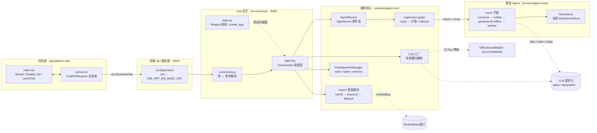
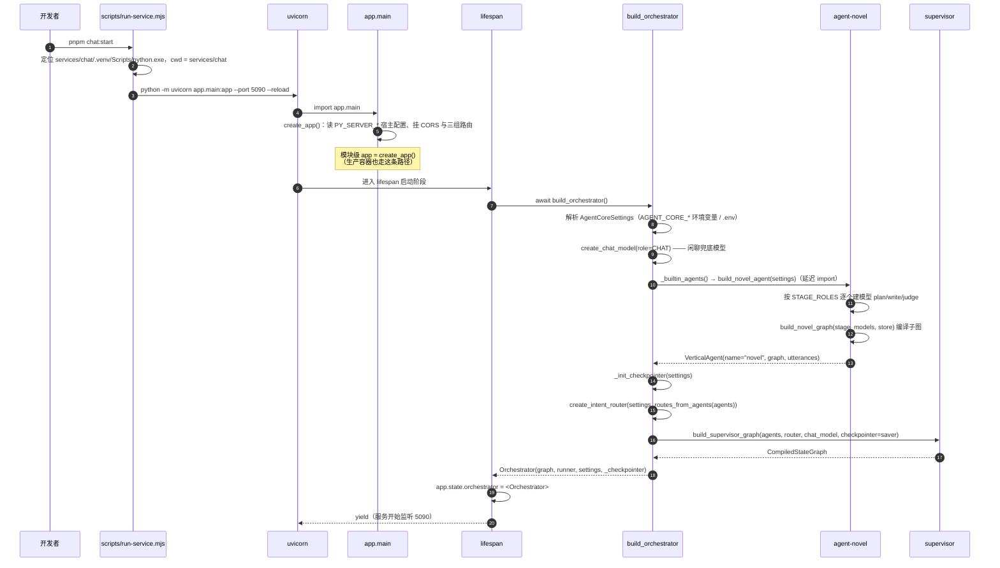
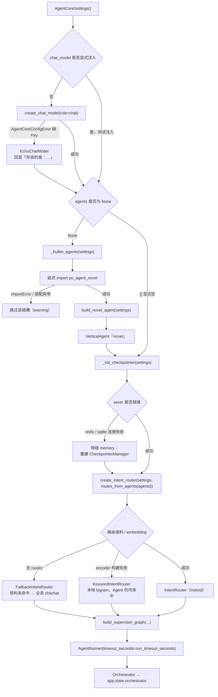
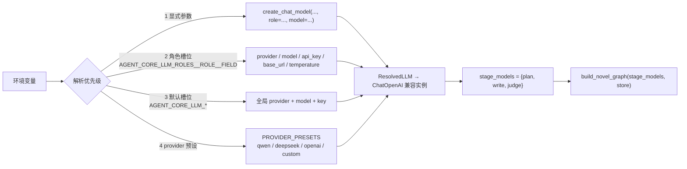
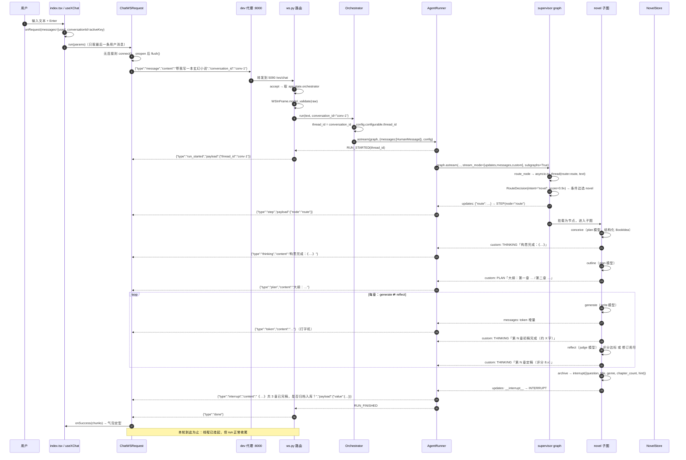
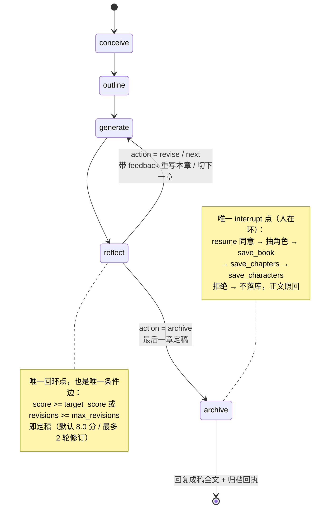
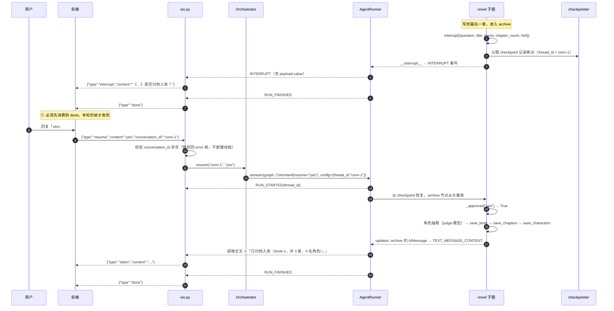
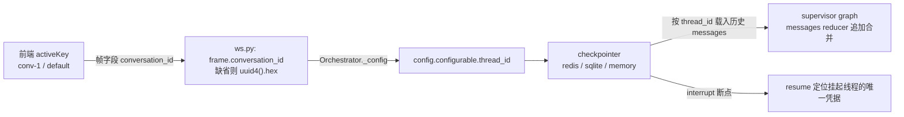

# novel Agent 全链路图：启动 → 运行 → 客户端往返

一张图看懂 novel Agent 从**进程启动**到**一次对话往返**的完整路径，包含三部分：

| 视角 | 回答的问题 | 对应章节 |
| --- | --- | --- |
| 启动装配 | 谁在什么时候把什么装进 Orchestrator？失败会怎样？ | [第 2 章](#2-启动装配链路) |
| 运行期 | 一条消息如何穿过 supervisor 进到 novel 子图，再变回浏览器里的字？ | [第 3 章](#3-运行期链路一条-message-帧的往返) |
| 往返约束 | interrupt/resume 为什么必须等 `done`？哪些节点会重跑？ | [第 4 章](#4-interrupt--resume-往返) |

> 图中所有节点名、帧名、字段名均取自当前代码；改了这些名字等于改了协议或前端展示口径。

---

## 0. 坐标：这份图涉及哪些文件

| 层 | 文件 | 职责 |
| --- | --- | --- |
| 浏览器 | `apps/admin-web/src/pages/chatbot/index.tsx` | 页面：`Sender` 输入、`Bubble.List` 渲染、`useXChat` 会话状态 |
| 浏览器 | `apps/admin-web/src/pages/chatbot/service.ts` | WS 客户端：`ChatWSRequest` 长连接、`run/flush` 发送、帧分发 |
| 前端 dev | `apps/admin-web/config/proxy.ts` | `/api/` → REST 后端；`/ws` → WS 后端（`ws: true`，仅开发态） |
| 协议类型 | `packages/types/src/chat.ts` | `ChatInFrame` / `ChatWSFrame` 的前端侧类型收口 |
| chat 宿主 | `services/chat/app/main.py` | 应用工厂 + lifespan：装配 Orchestrator、注册路由、关闭时释放连接 |
| chat 宿主 | `services/chat/app/routers/ws.py` | **唯一的协议翻译层**：入站帧校验 → `Orchestrator` → `AgentEvent` → 出站帧 |
| chat 宿主 | `services/chat/app/agent.py` | **装配层**：模型 / checkpointer / 路由 / 垂直 Agent 的选择与全部降级 |
| chat 宿主 | `services/chat/app/schemas.py` | `WSInFrame` / `WSOutFrame`（Pydantic V2） |
| 编排核心 | `services/agent-core/src/po_agent_core/runner/runner.py` | `AgentRunner`：LangGraph 流 → 统一 `AgentEvent` 流 |
| 编排核心 | `services/agent-core/src/po_agent_core/events.py` | `EventType` / `AgentEvent` 契约（**唯一真相**） |
| 编排核心 | `services/agent-core/src/po_agent_core/supervisor/graph.py` | supervisor：`route` → 垂直子图 / `chitchat` |
| 编排核心 | `services/agent-core/src/po_agent_core/routing/router.py` | Layer1 意图路由 + 两级降级链 |
| 编排核心 | `services/agent-core/src/po_agent_core/memory/checkpointer.py` | 三策略 checkpointer（redis / sqlite / memory） |
| 编排核心 | `services/agent-core/src/po_agent_core/llm/factory.py` | 角色槽位 → 模型实例（分阶段模型的落点） |
| 垂直 Agent | `services/agent-novel/src/po_agent_novel/agent.py` | 插槽装配：`NOVEL_UTTERANCES` + 分阶段模型 + 子图 |
| 垂直 Agent | `services/agent-novel/src/po_agent_novel/graph.py` | 子图本体：五节点 + 唯一条件边 + interrupt |
| 垂直 Agent | `services/agent-novel/src/po_agent_novel/offline.py` | 无 Key 时的离线模型（确定性占位，标注 `【离线模式】`） |

---

## 1. 全景图

一次问答牵动的全部角色与连线（不含 A2A/MCP，属 P3/P4 规划）：

**读图要点**

- 浏览器只认识**帧**（JSON），不认识事件、节点、模型：跨层契约只有两个 —— 入站 `message|ping|resume`，出站 13 种帧（见 §3.3）。
- `agent.py` 是唯一的「决策集中点」：模型、路由、checkpointer、垂直 Agent 的每一种失败都在这里被换算成某条降级路径，上层（WS/前端）零感知。
- 子图到 LLM 的三条虚线对应三种角色（plan/write/judge）——**同一张图可以有多个模型**，见 §2.3。

---

## 2. 启动装配链路

### 2.1 启动时序

从敲下命令到「可以收 WS 连接」为止发生的事：

**配置从哪来**：`AgentCoreSettings`（前缀 `AGENT_CORE_`，`services/agent-core/.../config.py`）与宿主 `Settings`（前缀 `PY_SERVER_`，`services/chat/app/config.py`）都读**进程 cwd 下的 `.env`**，同时接受真实环境变量；本地开发 cwd 是 `services/chat`，仓库根 `.env` 供 docker compose 使用。两者刻意分家：宿主参数（host/port/CORS）与编排参数（Key/checkpointer/路由）不混在一个 Settings 里。

### 2.2 `build_orchestrator` 逐段拆解

`services/chat/app/agent.py`，四步固定顺序，每步都有自己的降级出口：

### 2.3 novel Agent 装配：分阶段模型

novel 子图的节点在**装配期**按 `NODE_MODEL_ROLES` 声明的角色取模型（`graph.py`），运行期不再查表 —— 换模型 = 改配置 + 重启。

| 节点 | 角色 | 干什么 | 建议模型画像 |
| --- | --- | --- | --- |
| `conceive` | `plan` | 一句话 → 书名/题材/梗概（结构化） | 便宜、够聪明 |
| `outline` | `plan` | 全书章节规划（结构化） | 同上（同一颗「规划脑」） |
| `generate` | `write` | 章节正文（初稿 + 修订），**token 流式** | 贵、长文质量决定体验 |
| `reflect` | `judge` | 打分 + 意见（结构化），唯一回环判定点 | 快、便宜 |
| `archive` | `judge` | 角色抽取（结构化） | 同上 |

`STAGE_ROLES = ("plan", "write", "judge")` 即去重后的所需角色集合，装配层逐个建模型：

**三条安全规则（都是刻意的）**

1. **不配就是单模型**：`llm_roles` 为空时三个角色全部回落 `AGENT_CORE_LLM_*`，行为与单模型时代一致，前端/测试零感知。
2. **跨 provider 不复用密钥**：某角色声明的 `provider` 与全局 `llm_provider` 不同时，**不继承**默认槽位的 model / base_url / api_key，缺 Key 直接报错并点名 `AGENT_CORE_LLM_ROLES__JUDGE__API_KEY` —— 否则会把 A 家的 Key 发给 B 家。
3. **整体离线，不做混合链路**：任一角色解析失败，`_build_stage_models` 把**所有**角色换成 `OfflineNovelModel`。这避免了「真模型写正文 + 占位模型审稿」这种既不省钱又难排查的中间态。

关键词大小写不敏感、开放词汇：`AGENT_CORE_LLM_ROLES__WRITE__MODEL` 与 `...__write__model` 等价；角色名不必是枚举成员，但推荐用 `chat`/`plan`/`write`/`judge`。

### 2.4 装配期失败 → 降级点

启动永不因配置失败而中断，所有降级都在这一层收敛：

| 失败点 | 降级动作 | 用户可见现象 | 代码位置 |
| --- | --- | --- | --- |
| LLM 缺 Key | `EchoChatModel` | 闲聊回「你说的是：…」 | `chat/app/agent.py` |
| novel 包缺失/装配异常 | 跳过该插槽 | 小说意图走 chitchat 兜底 | `chat/app/agent.py` `_builtin_agents` |
| 任一阶段角色不可用 | 全角色 `OfflineNovelModel` | 正文带 `【离线模式】`，评分恒 9、不进修订 | `agent-novel/agent.py` |
| checkpointer 连不上 | memory（进程内） | 重启即失忆、多 worker 不共享 | `chat/app/agent.py` `_init_checkpointer` |
| 无路由语料 | `FallbackIntentRouter` | 全部走 chitchat | `routing/router.py` |
| embedding 缺 Key / 装配失败 | `KeywordIntentRouter` | 垂直 Agent 仍可被命中 | `routing/router.py` |

---

## 3. 运行期链路：一条 `message` 帧的往返

### 3.1 全时序

以「帮我写一本玄幻小说」为例，从键盘到屏幕的完整往返：

`done` 之前的每一帧都是**信息性**的：只有 `token` 累积成气泡内容，`done`/`error` 才是终止事件。

### 3.2 novel 子图内部状态机

supervisor 把 novel 子图**当作一个节点**挂载（`builder.add_node("novel", agent.graph)`），子图内部的节点会以 `STEP` 事件上浮（靠 `subgraphs=True`）。

**领域状态全部在 `CoreState.artifacts["novel"]` 命名空间**（supervisor 不解释）：`brief / idea / outline / chapters / index / draft / feedback / revisions / action / book_id`。

**节点 → 模型**：`conceive`/`outline` → plan，`generate` → write，`reflect`/`archive` → judge（见 §2.3）。

**两个易错点**：子图 `compile()` **不挂 checkpointer**（由父图统一供给，否则会产生第二份状态破坏恢复语义）；`generate` 节点一处绑定 write 模型同时服务初稿与修订（靠 `feedback` 是否为空分流提示词）。

### 3.3 事件 → 帧映射

`ws.py` 的 `_EVENT_TO_FRAME` 是**唯一**的翻译表，新增事件必须在这里登记，否则被静默丢弃（内部事件不泄漏给前端）：

| `AgentEvent`（核心） | WS 帧（前端） | `payload` 关键字段 | 来源 |
| --- | --- | --- | --- |
| `RUN_STARTED` | `run_started` | `thread_id` | runner 在进入图之前发 |
| `THINKING` | `thinking` | `stage` / `title` / `chapter` / `score` … | 子图 `_emit` 的 custom 流 |
| `PLAN` | `plan` | `stage: "outlined"` / `chapters` | 同上 |
| `STEP` | `step` | `node`（可能是子图内部节点名） | 每个有更新的节点 |
| `TEXT_MESSAGE_CONTENT` | `token` | `node` | `messages` 流（打字机）或 updates 补发 |
| `TOOL_CALL_START/ARGS/END/RESULT` | `tool_call_*` | `tool_call_id` / `name` / `status` | 工具调用（novel 当前不用工具） |
| `INTERRUPT` | `interrupt` | `value`（完整载荷字典） | `__interrupt__` updates，按 `id` 去重 |
| `RUN_FINISHED` | `done` | — | runner 收尾 |
| `RUN_ERROR` | `error` | `error_type` / `timeout_seconds` | 超时或异常，**终止帧** |
| `TOOL_APPROVAL_REQUEST` 等 | *（未登记）* | — | 丢弃，留给 P3/P5 审批流 |
| — | `pong` | — | `ping` 帧的直接回应，不经过编排器 |

**为什么是「事件」而不是「帧」**：核心库不认识 WebSocket。A2A SSE（P4）、MCP 通知（P3）将来消费的是**同一条** `AgentEvent` 流，只是换成另一张映射表。

### 3.4 前端各帧的处理（`service.ts`）

| 收到帧 | 前端行为 |
| --- | --- |
| `token` | 推入 `chunks`，`onUpdate` → `transformMessage` 追加内容 → 气泡打字机 |
| `done` | `requesting = false`，`onSuccess(chunks)` → 气泡定型 |
| `error` | `requesting = false`，`onError(content)` |
| `pong` | 直接 return（心跳） |
| `run_started` / `step` / `thinking` / `plan` / `tool_call_*` / `interrupt` | **信息性透传**：不结束请求、不触发回调（当前实现即忽略） |

心跳：连接建立后每 30s 发 `{"type":"ping"}`，服务端回 `pong`，不触碰编排器。

### 3.5 已知现象与注意事项

- **`token` 帧的真实来源**：章节正文由 `generate` 节点的 `write` 模型逐 token 流式产出（打字机效果）。结构化输出调用（构思/大纲/审稿/角色抽取）**视 provider 而定**可能上浮 `tool_call_start`/`tool_call_args` 帧（工具名即 schema 名，如 `BookIdea`）；前端目前一律忽略，属预期现象，不是 bug。
- **归档回执是一次性 `token` 帧**：`archive` 节点的回复是代码拼装的字符串（非模型输出），因此整段一次性到达，不是逐字流。
- **前端只发最后一条用户消息**：历史由服务端按 `thread_id` 从 checkpoint 载入，客户端不需要（也不应该）重放上下文。
- **客户端用自身会话键当 `conversation_id`**：`activeKey`（`default` / `conv-1` …）被直接当成 thread_id。这是刻意的简化解法 —— 只要同一会话的 key 稳定，多轮记忆就成立；若客户端**不传**，服务端会为每条消息新生成一个 thread，记忆随即丢失。

---

## 4. interrupt / resume 往返

这是全链路唯一「需要客户端二次输入」的地方，也是时序最容易写错的地方。

### 4.1 时序：第一轮 run 收尾后再 resume

### 4.2 `resume` 的重放语义

- **不会重跑整条链路**：`Command(resume=value)` 让图从挂起节点继续，`conceive / outline / generate / reflect` **不会**重新执行（它们的产出已在 checkpoint 里）。已实测：resume 一轮里只有 `archive` 相关调用发生。
- **`archive` 节点从头重放**：因为 `interrupt()` 的返回值就是 resume 值，节点函数会**重新执行一遍**。因此 `interrupt` 之前的代码必须无副作用 —— 当前只有一次 `_ns(state)` 纯读取，符合约束。**在 `interrupt` 之前加写库/计数代码是危险改动**。
- **确认词表**：`_APPROVE_WORDS = {"yes","true","1","ok","确认","同意","是"}`，大小写不敏感、前后空白容忍；其余回复都视为「暂不归档」，正文照回、不落库。
- **`resume` 必须带 `conversation_id`**：缺了就回 `error` 帧而不是新建线程（路由层与 `Orchestrator.resume` 各校验一次），避免用户以为「确认了」实际开了新线程。

### 4.3 当前前端接入现状（缺口，非缺陷）

| 能力 | 服务端 | 前端 |
| --- | --- | --- |
| 帧类型定义 | `WSInFrame.type` 含 `resume`；`WSOutFrame.type` 含 `interrupt` | `packages/types/src/chat.ts` 已同款定义 |
| 发送 `resume` | ✅ `orchestrator.resume` + 时序约束齐备 | ❌ `ChatWSRequest` 只发 `message` / `ping` |
| 渲染 `interrupt` | ✅ 载荷字段齐备（`question` / `hint` / `title` …） | ❌ `handleFrame` 走「信息性透传」分支，忽略 |

后果：**小说链路当前的确认环节在浏览器里无法作答** —— 用户会看到 interrupt 帧被忽略、run 以 `done` 收尾，书籍不会入库（正文仍会照常显示）。要接通只需两处改动：`handleFrame` 增加 `interrupt` 分支（存下载荷并渲染确认卡片），以及 `run()` 之外暴露一个发送 `resume` 帧的方法（沿用同一条连接与 `conversation_id`）。服务端无需改动。

---

## 5. 记忆：`conversation_id` ↔ `thread_id` ↔ checkpoint

- **同一 id 才命中同一份检查点**，换 id 等于开新会话；历史消息由 checkpoint 载入并与本轮 `HumanMessage` 合并（`add_messages`），因此客户端无需重放上下文。
- **短记忆**（对话轮次、interrupt 断点）在 checkpointer；**长记忆**（`BaseStore`，user namespace）已预留参数但宿主尚未启用。
- 降级到 memory 时记忆退化为进程内：重启失忆、多 worker 互不可见 —— 只影响记忆持久性，不影响可用性。

---

## 6. 降级矩阵（全链汇总）

| 层 | 正常态 | 降级态 1 | 降级态 2 | 兜底 |
| --- | --- | --- | --- | --- |
| 闲聊模型 | `create_chat_model(role=chat)` | — | — | `EchoChatModel` 回显 |
| 小说模型 | plan/write/judge 各配各的 | 不配则全部用默认槽位 | 任一角色失败 → **全角色离线** | `OfflineNovelModel`（恒 9 分、不进修订、正文带 `【离线模式】`） |
| 意图路由 | `IntentRouter`（稠密 + BM25 混合） | `KeywordIntentRouter`（本地 bigram） | — | `FallbackIntentRouter`（全走 chitchat） |
| checkpointer | redis（生产）/ sqlite（单机） | — | — | memory（进程内） |
| 垂直插槽 | novel 已挂载 | novel 装配失败 → 跳过该插槽 | — | chitchat 单节点图 |
| 运行超时 | 正常收尾 `done` | — | — | `RUN_ERROR`（唯一终止帧，不再补 `done`） |

`RUN_ERROR` 的两种触发：超时（`timeout_seconds`，默认取 `AGENT_CORE_RUN_TIMEOUT_SECONDS`）与未捕获异常。**取消（`asyncio.CancelledError`）不上报**，原样抛出以支持断连终止。

---

## 7. 落点索引（改代码前先看这里）

| 想改什么 | 改哪里 |
| --- | --- |
| 换某阶段的模型 | 环境变量 `AGENT_CORE_LLM_ROLES__<角色>__*`；角色归属改 `graph.py` 的 `NODE_MODEL_ROLES` |
| 改章节数 / 字数 / 定稿分 / 修订上限 | `build_novel_agent(..., chapter_count, chapter_words, target_score, max_revisions)` |
| 改节点拓扑或加节点 | `agent-novel/graph.py`（同时确认 `STAGE_ROLES` 与 `NODE_MODEL_ROLES`） |
| 改归档确认词 | `graph.py` 的 `_APPROVE_WORDS` |
| 加一种 WS 帧 / 事件 | 核心 `events.py` → 宿主 `ws.py` 的 `_EVENT_TO_FRAME` → `schemas.py` 的 `WSOutFrame.type` → `packages/types/src/chat.ts` |
| 换记忆后端 | `AGENT_CORE_CHECKPOINTER`（redis / sqlite / memory）与 `AGENT_CORE_REDIS_URL` / `AGENT_CORE_SQLITE_PATH` |
| 换落库实现 | 实现 `NovelStore` 协议（`save_book` / `save_chapters` / `save_characters` / `list_books`）后从 `build_novel_agent(store=...)` 注入 |
| 新增垂直 Agent | 实现 `VerticalAgent(name, description, graph, utterances)` 插槽，name 与路由 `Route.name` 对齐 |

> 契约红线：`agent-core` 不得 import fastapi/flask/uvicorn/starlette（由 `tests/test_architecture.py` 强制）；WS 帧名与 `WSOutFrame.type` 是前端契约，改名即破坏前端。

---

## 相关文档

- `services/agent-novel/README.md` —— 子图结构、降级策略、数据层协议
- `services/agent-core/README.md` —— 编排核心能力清单与多模型配置
- `services/chat/README.md` —— 宿主启动方式与 WS 协议
- `.env.example`（仓库根） —— 全部可配项与多模型示例
